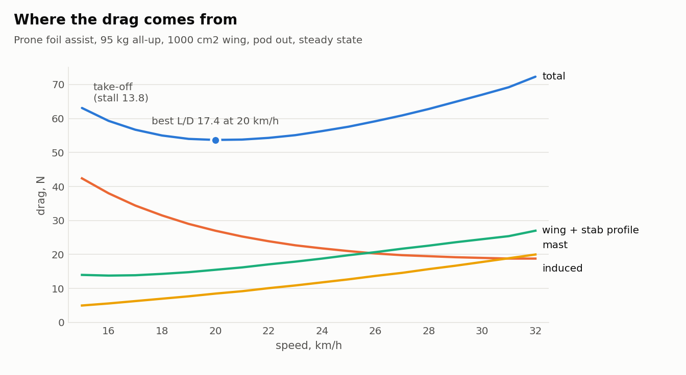
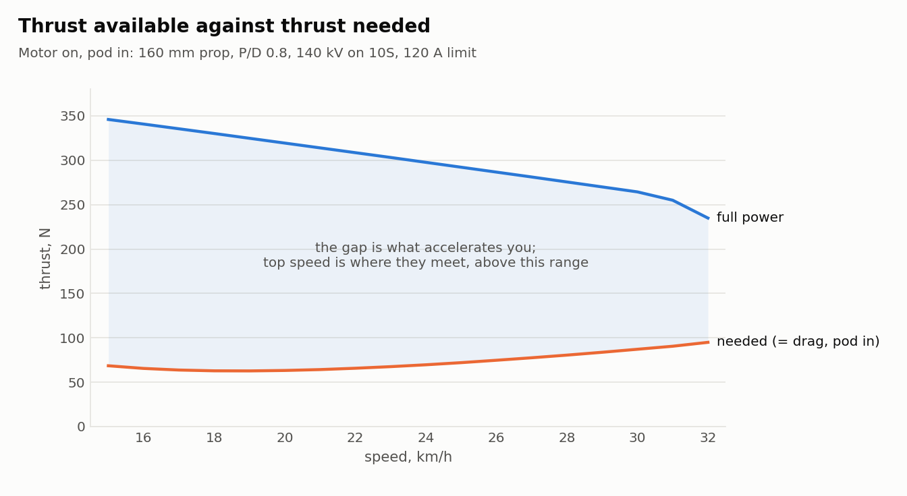
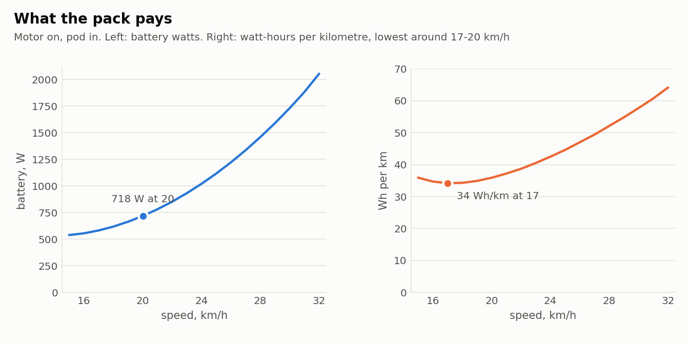
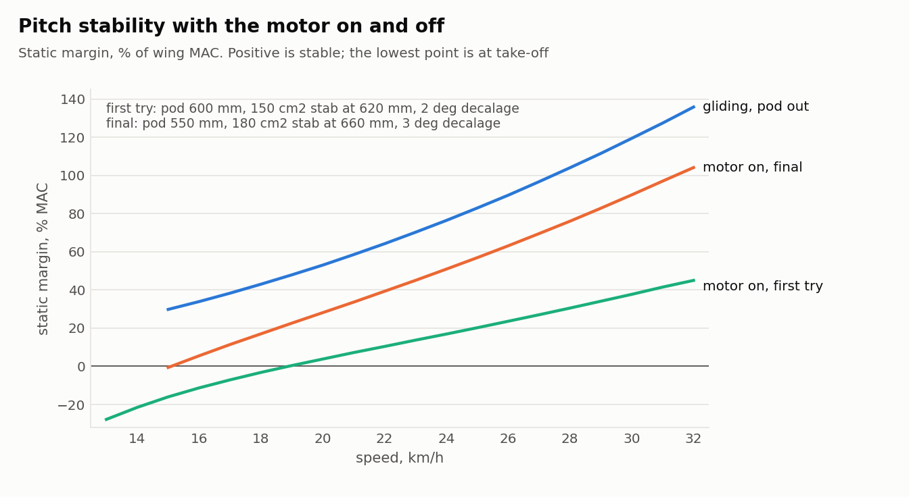
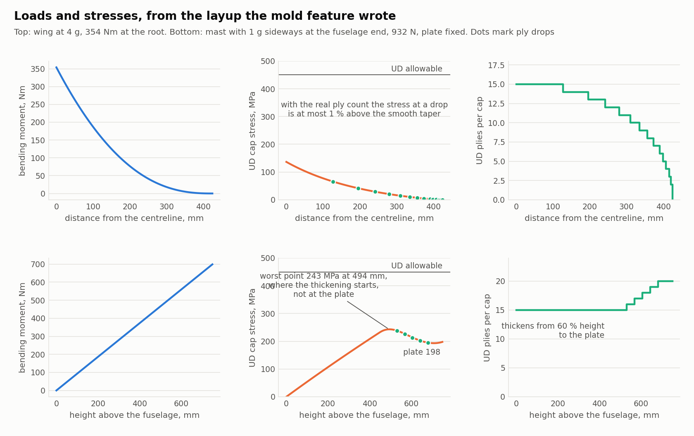

# Foil Design Tool for Onshape

**User guide, design notes and parameter reference. Build 245 (wing 1.070, stabiliser 4.036, performance 1.030, mast 2.011, fuselage 5.008, mold 2.148).**

By JB69. Licensed under Creative Commons Attribution-NonCommercial-ShareAlike 4.0 (CC BY-NC-SA 4.0): share and adapt it for non-commercial use, with credit, under the same licence.

**Two things before anything else.** First, this is a modelling exercise, not the advice of a foil builder. The tool started as a side quest to the B-series propeller blade generator: sizing a prop needs a drag curve, a drag curve needs a foil, and a nine-hour flight turned that into six features. Second, every number the tool produces is a steady-state, constant-value estimate: one speed, one weight, flat water, a rider who doesn't move. Real foils live in chop, pumping, turns and landings, and they break on peaks and repetition. Trust the trend from one variant to the next; treat absolute numbers, stall speed especially, as optimistic until you have calibrated them against something you have ridden (see 10.1).

This document accompanies the *Foil design* Feature Studio. It explains what the tool does, how the six features work together, what every parameter means and how to use it, and the hydrofoil design and construction knowledge that was worked out while building it. It is written for a rider who designs and builds their own foils: pump, SUP and surf, wing, windfoil, kite and eFoil are all first-class targets.

## Contents

1. What the tool is
2. Quick start
3. The six features
4. Reading the results
5. Design knowledge
6. Building knowledge: layup, structure, molds and printing
7. Worked example
8. Parameter reference
9. Console log reference
10. Model limits, versioning and the AI assistant

---

# 1. What the tool is

The tool is a single Onshape Feature Studio containing six custom features. Used in order in a Part Studio, they turn a handful of design decisions into a complete hydrofoil: front wing, stabiliser, mast with an optional motor pod, round tube fuselage, a full performance and stability analysis, and a set of 3D-printable molds with a layup schedule and fabric cutting templates.

| Feature | What it makes | Reads | Publishes |
|---|---|---|---|
| **Foil wing** | The front wing, optionally with a tube socket and nacelle for a round fuselage | nothing | area, span, MAC, incidence, zero-lift angle, the analysis model, the socket position |
| **Foil stabiliser** | The rear wing, placed by Arm and Height behind the wing, optionally linked to the wing, with the production-style mount pad, tail fairing and bolt holes | the wing (link ratios, the tube socket axis the seat Height is measured from) | area, position, the mount contour and bolt pattern |
| **Foil performance** | No geometry. A speed sweep of lift, drag, trim, stability, structure, propulsion and energy | wing, stab, mast, fuselage | the spanwise bending loads used by the mold's stiffness check |
| **Foil mast** | The mast: tapered, thickened at the top, with a root fillet into the board plate, optional motor pod with a placeholder cavity, plate with bolt holes | the wing pivot (position only) | the mast law and plate for the mold and the fuselage pocket |
| **Foil fuselage** | The round tube: spigot into the wing socket, seat cut to the stab's mount contour, tapped holes matching the stab's bolts, mast pocket | wing socket, stab mount, mast | the fuselage shape for performance |
| **Foil mold** | Two-part (mast: three-part) printable molds for the wing, stab or mast: parting curtain, locator keys, pinch-off groove, undersized bolt cones, plugs, printer tiling, plus the layup, material and resin estimate, stiffness check and cut-template plate | the part and every model above | nothing |

**Frame and conventions.** X points downstream (leading edge to trailing edge), Y along the span, Z up. The wing's root pivot, the quarter chord by default, sits at the world origin. Sections are streamwise. Incidence is positive leading edge up. *Decalage* is wing incidence minus stab incidence. Span is the projected tip-to-tip distance seen from above. Area is projected by default and always reported.

**Design philosophy, as decided during development.**

- Everything is parametric and mathematical: no sketches to draw, no freehand surfaces. Change a number, regenerate, read the notice.
- Foil area is a first-class input. You choose an area and an aspect ratio; the planform is solved to hit them exactly.
- The stab's arm and height are design decisions that belong with the wings. The mast and fuselage are structural parts that read those positions and never set them. The one deliberate exception is the stab's *Height*, which is measured from the wing's tube socket axis so its mount always lands on the fuselage.
- Discipline-neutral: nothing assumes an eFoil. Every tooltip gives typical values by discipline.
- Foils are carbon laid up in printed molds, not printed parts. Structural advice assumes carbon: woven skins, unidirectional caps and carbon tow.
- Every parameter has a short label so its value stays visible in the dialog, and a tooltip with limits, typical values and what the parameter does.
- Warnings tell you which field in which feature fixes the problem.

# 2. Quick start

1. In a Part Studio, open *Add custom features*, search for **Foil designer** and add it. The six features appear in the toolbar. This guide is the PDF in the same public document: right-click any of the features and choose *Open linked document* to find it again, and that document also has an example Part Studio with all six features placed.
2. Add **Foil wing**. Pick a discipline-appropriate area, aspect ratio and section; leave the rest at defaults. The notice shows the area achieved, span, MAC and root chord.
3. Add **Foil stabiliser**. Set Arm, and Height as the seat offset from the fuselage centreline (−4 mm with the pad on top). Leave *Link to wing* on to size the stab as a fraction of the wing; the decalage is then set by *Link decalage*. Turn on the *Mount pad* if the stab will bolt to a tube fuselage.
4. Add **Foil performance**. Enter rider plus board mass, water, ride depth and the speeds you care about. Read the notice: L/D and power at cruise, stall, take-off margin, trim CG, static margin, root bending and cap thickness. Turn on *Log inputs* and open the FeatureScript console for the full sweep as CSV.
5. Add **Foil mast** and **Foil fuselage** when you want the structure. The performance feature picks up their drag automatically, and *Joint finish* counts the joints, so *Other cm²* is only for fittings.
6. Iterate here, before any mold exists. The wing, stabiliser and performance features regenerate in seconds; a mold takes minutes, and two molds double it, so settle the design first and add the molds last. If a mold is already in the studio, suppress it while iterating, or set its *Detail* to Preview. Change one or two things at a time and compare notices. The console lines (`WING_INPUTS`, `STAB_INPUTS`, and so on) capture every input and are what you paste when asking for help, whether on a forum or to the AI assistant in section 10.3.
7. Add **Foil mold** for each part you will build, once the design is settled. Select the part, set your printer's bed size, and read the layup and stiffness lines. Turn on *Cut templates* to get a plate whose top face exports as one DXF of every fabric shape.
8. Keep any custom geometry that the mold must follow, such as a hand-modelled motor cavity in the pod or fillets and chamfers on the mast's plate, *above* the mold feature in the feature list. The mold cuts its cavity from the part as it stands, and shapes the mast's plate lid and the halves' plate pocket from the plate as modelled.

## 2.1 The download package

Everything outside Onshape comes as one zip, `foil-design.zip`, from the GitHub repository at https://github.com/jb69/Foil-Design-Tool (direct download: https://github.com/jb69/Foil-Design-Tool/raw/main/foil-design.zip). Unzip it anywhere; nothing installs. This guide's PDF is in the repository as well, so it can be read in the browser without downloading the zip.

| In the zip | What it is for |
|---|---|
| `foil_design.fs` | The Feature Studio source. Only needed if you want your own copy of the features rather than the published ones: in your Onshape document create a Feature Studio, select all its text and paste this file over it. The six features then appear under *Custom features* in that document's Part Studios. |
| `docs/` | This guide as PDF and as Markdown, its charts, and `parameters.md`, a table of every dialog field with its limits, default and tooltip |
| `assistant/` | The AI assistant of section 10.3: the Claude skill, the portable file for other assistants, its four scripts and a README with the setup for each |
| `examples/` | Two complete console logs and a speed sweep to try the assistant on before you have a design of your own |
| `LICENSE` | CC BY-NC-SA 4.0 |

Use the package like this: add the features in Onshape (step 1 above, or paste `foil_design.fs` for your own copy), design with the guide open, and when a run needs a second opinion, give the assistant in `assistant/` your console log. the project's design notes is the place to start when you want to model a foil you know: each document lists the dialog values, feature by feature.

# 3. The six features

## 3.1 Foil wing

The wing is built from an area-first planform solver: you give target area and aspect ratio (or span and root chord), the chord distribution shape (superellipse of exponent *n*, linear taper, or double taper), and the solver finds the root chord that hits the area exactly. On top of that: an alignment line (which chord fraction stays straight in plan), power-law sweep, tip drop with an anhedral exponent and optional root dihedral, washout, a thickness distribution from root to tip, incidence about a chosen pivot, a tapered or rounded tip cap, and a minimum tip thickness.

**Chord distribution.** *Superellipse* gives the rounded outline most wings have: exponent 2 is elliptic, 3 to 4 fuller with squarer tips, and the end ratio sets the small end face. *Linear taper* is a straight taper to a square tip. *Double taper* is two tapers: a steep one from the root to *Break %* of the half span, where the chord is *Mid ratio* of the root, then a gentle one to *Tip ratio*, with *Blend %* rounding the corner between them (0 for a sharp kink). That is the full-base shape of many current stabs, and of a high-aspect wing with a broad centre section. Linear and double tapers end square; *Tip cap* = Rounded + plan shrinks the chord along the cap's quarter-ellipse as well as the thickness, centred on the mid-chord whatever *Align line %* is, so both tip corners round and the area solver allows for it.

**Span line.** *Tip drop* is the anhedral, how far the tip sits below the root; *Drop shape* is how it is spread. *Power law* with *Drop exp* steepens all the way to the tip (2–3 gives a flat centre with the tips dropping late). *S-curve* is a smoothstep: flat at both ends and steepest in the middle, so the wing levels off again before its tips; that is the gull front view of many surf wings. *Drop from %* and *Drop to %* set where the drop starts and finishes; beyond *Drop to %* the line runs level until a winglet bends it. *Gull dihedral* is the slope leaving the root for a true gull that rises before it falls. With either on, the loft adds stations through the drop, about 17 of them (build 235), so the surface follows its law between them; before that a wing with few *Stations* drooped almost straight from the root over its first span and lay up to 1.6 mm below its own law there, which the mold's parting followed, so the lower half lapped over the thin trailing edge. From build 230 the wing and stabiliser notices say what the span line does in roll: *rolls like x° of anhedral (Cl_beta …, this surface alone)*, the straight anhedral folded at the root that would roll the same, from a vortex-lattice model of the surface's own drop, gull, winglets and sweep. A 35 mm S-curve on a 900 mm wing reads about 5°; upturned tips take back about half a degree. It compares shapes; the mast and the rider decide how the whole foil feels in roll.

**Winglets.** *Winglet* Up or Down bends the outer part of each half span through *Winglet angle* on an arc of *Bend radius*, then straight to the tip. Its size is *Winglet area*: the chord distribution continues along the bend, and the tool solves how much of the half span to bend so that area comes out. For a fin-like winglet use a small radius, 20 to 40 mm; for the smooth upturned tip of a downwind wing set *Bend radius* near the winglet's own length (150 to 250 mm), so the whole winglet is the arc and there is no straight leg to read as a kink. Every section beyond the bend is drawn square to the bent path, so a 90° winglet keeps its true section; the old route, *Tip drop* with a high *Drop exp*, keeps the sections vertical and only suits a gentle upturn. Area and aspect ratio stay the developed values of the whole half span, winglet included; the notice adds the winglet height, its projected area and the projected span. Foil performance credits a winglet as extra effective span for induced drag (0.9 × its height across the pair, the usual first estimate). Foil mold molds a winglet up to 75°: the parting follows the bent tip, and the mold block grows by the winglet's height; steeper winglets cannot release from a two-part mold pulled vertically.

**Leading-edge tubercles.** *LE tubercles* puts tubercles on the leading edge: it moves forward and back sinusoidally along the span by *Tubercle amp* peak to trough, every *Tubercle pitch*, between *Tubercles from* and *Tubercles to*, fading in and out over half a pitch at each end. The trailing edge stays where it is, so the chord swells at each peak; the section is stretched there with its thickness in millimetres unchanged. Six stations per pitch are added so the loft draws each tubercle, which slows regeneration. Foil mold follows the tubercles exactly.

The theory. Tubercles come from humpback whale flippers. Each tubercle sheds a pair of streamwise vortices that carry high-energy flow into the boundary layer behind the troughs, so the flow there stays attached to a higher angle of attack, and the wing's stall becomes gradual and partial instead of sudden: wind-tunnel tests (Miklosovic and others, 2004; Johari and others, 2007) show the stall angle rising by several degrees and lift retained well past it, with a small drag penalty below stall and, on some sections, a small loss of maximum lift. On a foil that is take-off, pumping and hard turns, which is where the makers put the claim.

The caveat, and what the tool says instead. *Foil performance's figures ignore the tubercles.* Its lift and drag come from lifting-line theory on the smooth chord distribution and from two-dimensional section polars, and neither can see a spanwise-periodic leading edge: the stall speed, the take-off margin and the drag in the sweep are the plain wing's, always. From build 232 the feature adds a separate line to its notice and a block to its report, *LE tubercles, reported apart*, with the *Tubercles* switch in its Section and drag model group, and it is deliberately never folded into the figures above it. The line has two parts. The charge the tool can compute: the chord swells by half the tubercle height at each peak and shrinks by it in each trough, the loading cannot follow a ripple shorter than a chord, so the local lift coefficient rises in the troughs by the chord's own fraction (2.5 % for 5 mm tubercles on a 111 mm chord) and the first stall begins there, a little earlier; the line gives the take-off loading and stall speed with that trough-first stall. Then the published credits, applied to the same two numbers: a section CL max between −5 % (two-dimensional tests at low Reynolds number) and +6 % (the humpback flipper at Re 0.5 million, Miklosovic 2004), the flipper's +4° of stall angle as a bound, and the lift held past stall that is the real point of tubercles, which the sweep cannot represent at all because its polars have no post-stall branch. The drag before stall is of unknown sign within about 8 % of the wing's profile drag, and the line says so with the glide range it implies. It also says whether the height and pitch, as fractions of the chord, lie inside the tested range. Treat the line as the size of a build choice, and calibrate the stall against a ridden foil as section 5.3 describes; a smooth and a tubercled wing from the same molds is the test that would settle the credits.

**Sections.** NACA 4-digit is fully parametric (camber, camber position, thickness). Seven published sections are built in as digitised coordinate tables: Eppler E817, Eppler E818, NACA 63-412 and Clark Y, the classic flat-bottomed section whose lower surface is straight from 30 % chord back. A tabulated profile fixes its own camber; Root and Tip thick % scale its thickness. *Tip profile* lets the section change along the span (give the Foil mold 22 or more *Split stations* when it is on; the parting needs them where the section changes): the root section runs out to *Blend from %* and then blends point by point into the tip section (any of the five, with its own *Tip camber %* and *Tip camb pos %* for NACA), reaching it at the tip, the way production wings run a cambered root out to a flatter, thinner-nosed tip that stalls later. The mold follows the blend, and so does the performance sweep (section 4.4). The trailing edge is held at a real thickness for moldability and thinned automatically near the tip so it never exceeds 3 % of the local chord.

**Fuselage joint.** Four ways to attach the fuselage, chosen under *Joint*. *Flat mount (bolted through)* is the simplest, and the usual one on home-built foils: the wing's underside sits on a flat fuselage bar and countersunk bolts go straight down through the wing on the centreline into the bar, set by *Bolts*, *Bolt*, *Bolt 1 from* the leading edge, *Bolt pitch* and *Countersink*; each hole is checked against the root chord and the laminate left under its head. A wing bolted straight onto a bar seats on its underside's own line, not at the angle it was drawn: the tool's Clark Y has its flat 2.1° from its chord, and a cambered NACA underside rocks on its curve. So the joint carries a *Mount pad* (on by default, build 227): a flat horizontal face *Pad width* wide and *Pad height* below the underside's lowest point, its top following the root's own lower surface, from *Flat start* behind the leading edge to the trailing edge, faired from the nose by the *Front ramp* or begun square. It is the shim that sets the typed *Incidence* against the bar; the bolts pass through it and the laminate under each head counts it. Where the underside already lies on the pad plane, a Clark Y drawn at 2.1° with *Pad height* 0, no pad body is built. Any other section's face sits at least 0.3 mm below its lowest point (build 238): a face on the point itself touches the skin along a line, and the mold's cavity cut fails there. The notice reports the seat line, the edge of the underside's lower convex hull under the bolts' resultant, and the angle the wing would run at on a bare bar; with the pad off that becomes a warning, with the incidence to type to analyse the wing as built. In the mold the holes come out as pins from both halves, the countersinks on the upper half, and the pad molds in the half that forms the underside. *Round tube socket* is the tool's original: a nacelle blended onto the root with a bore for a round tube, held by cross pins. *Square socket* is the same nacelle with a rectangular bore for a flat-sided tongue or an extruded aluminium flat bar; *Bore corner* rounds the bore's corners as bar stock's are (enter no more than the bar's own radius), and the clearance is split between the two sides as it is for the round bore. *Flat hub with pocket* is what most production wings do: a flat-topped hub on the root, level with the section's apex and running aft from it past the trailing edge with a flat underside at the trailing edge's height, a shallow recessed pocket the fuselage's flat nose drops into, and blind holes for bolts that come down through the fuselage into the wing, into bonded inserts. The hub is a D in plan, a semicircle at the front and a square back, and the pocket runs from its front wall out through that back, open, so it is the start of the fuselage interface: the tongue is located by the front wall and the sides. *Hub above apex* may sink the hub well below the section's centre; the underside then follows it down to keep floor under the pocket, and the notice warns where the pocket floor would break through the lower skin. It gives the thinnest root, the stiffest joint, and a mold with no plug, since the pocket molds from the upper half. The two sockets hold their fuselage with countersunk bolts through the nacelle's top, and *Socket height* moves the bore off the mid-thickness. *Hub* = Standard fixes the hub's dimensions so one fuselage fits every wing built with it: 40 wide by 92 long, a 3 mm join fillet, the pocket 24 wide by 5 deep from 20 mm behind the front, three blind holes at 20 mm pitch from 15 mm behind the pocket's front wall, 10 mm deep, the count and positions the fuselage was drawn with; you choose only the bolt size (*Hub bolt*, M5, M6 or M8) and the position (*Hub from apex*, *Hub above apex*). *Hub* = Custom opens every dimension, so a fuselage you own can be measured and matched, and *Tongue length* is published for the fuselage; the notice reports the wall left under each hole. It also opens *Bolts from* (build 235), which side the bolts come from. *Fuselage* is the joint above, bolts down through the tongue into blind holes. *Wing underside* turns them round for a metal bar sitting in the pocket: a clearance hole for the *Hub bolt* (M5 5.4, M6 6.4, M8 8.4 mm) at each bolt position on the centreline, from the lower skin up to the pocket floor, with a 90° countersink in the lower skin to the head diameter so the heads sit flush, and the bar or the fuselage's tongue is tapped instead. Each hole starts where the wing's underside really is, read off the part by a ray cast up the bolt's axis. The notice gives the laminate left between each countersink and the pocket floor and warns under 2 mm, as the flat mount does; put the bolts where the root is thick, and keep *Clear joint* on in Foil mold so they pass through solid laminate, not foam. *Fuselage, nut inserts* (build 241) brings the bolts down through the fuselage and right through the wing into flanged nut inserts pushed into the underside, a hand fit: a clearance hole, a bore for the insert's barrel (*Insert dia*, *Insert length*) and a flush recess for its flange (*Flange dia*, *Flange thick*), all at *Insert fit*. A bolt into a nut takes full preload, which tapped carbon cannot hold, and the clamp is what carries twist and yaw at the joint: the notice estimates it (A4-70 at 70 % of yield) with the twist the face holds before it opens, the yaw before it slips, and the bearing under each flange, and warns when an insert reaches within 1 mm of the pocket floor, where the bolt would no longer clamp the laminate. Keep the root solid round the inserts (*Clear joint* and *Core clear* in Foil mold); the mold forms the bores and recesses from its lower half. The Standard hub keeps its bolts from the fuselage. A bar or fuselage in the pocket stands proud of the hub, and production foils fair its front into the wing: *Nose fairing* (rebuilt in build 241, wing 1.070) does that as one lofted body, not a hump with fillets. From a nose point *Fairing length* ahead of the pocket's front wall a ridge rises on the top skin to *Nose height* above the hub's top at the wall, the bar's or fuselage's top, where its back face is flat on the wall's plane for the bar or the hub body to butt against; left at 0 it comes to the hub body's default top (22 mm above the hub's underside), so the tool's own fuselage meets it with nothing typed, and a bar of your own is the custom case. *Top shape* sets the ridge's cross-section from a pointed tent through round to flat (it eases to the bar's flat top over the hub), *Nose fullness* its outline in plan from a straight taper to a blunt ogive, and *Crown round* the back face's top corners to match the bar's edge. Its feet are concave arcs into the skin, scaled with the outline and squeezed by the root fairing's *Fairing spread*; at the wall its section is the root fairing's own, so the side fairing runs on from it as one surface, and the root fairing then runs the sides only, from the wall back. It needs *Root fairing* on, takes the hub's full width at the wall, and its nose point is held 10 % of the chord behind the leading edge. Foil mold's upper half molds it with the rest of the hub, and the cut list adds its volume to the root's solid fill. *Pocket floor* (build 241) shapes the pocket's floor and the fuselage tongue on it: *Flat*, *V groove* (the floor falls from the walls to a V on the centreline) or *V ridge* (it rises to one), *V depth* deep, its apex and shoulders rounded at *V fillet*. The tongue then sits on the V's two faces, so side loads and roll are carried by faces the bolts wedge together rather than by the walls' clearance, and it self-centres. The centreline, where the bolts are, stays at *Pocket depth*: a groove raises the floor at the walls instead, so the laminate under the bolts is what a flat floor leaves, and a ridge adds to it. The notice warns when the walls are left under 1.5 mm tall, or a ridge leaves under 1.5 mm over its crest. The hub body's tongue takes the matching V at the same *Clearance* all round. The join between the hub and the skin is filleted (*Hub fillet*), and the fillet is built so that it cannot fail: a fillet of radius r needs a wall at least r tall along its whole edge, and with the hub's top level with the apex the wall is nothing at the front, so the hub is first made taller than any skin under it by the radius, the part of it below the skin is discarded, the closed loop where its walls meet the top skin is filleted, and the top is then cut back to *Hub above apex* with a tool that has the wing's own shape removed from it. Where the wall was shorter than the radius that leaves the fillet's lower arc, so the top fades into the skin through a flare instead of a step. The filleted part of the hub stops a few millimetres ahead of the trailing edge, checked on the real skin by ray casts at the fillet's feet; the rest, on the thin trailing edge and beyond it, is a plain block. Build 185 adds the hub on the wing; the fuselage's flat tongue follows. *Root fairing* (build 241, wing 1.064) replaces the fillet with a lofted flare: one body runs along the hub's D in plan, round its front and down both sides, each section a concave arc tangent to the hub's wall and running into the skin, its radius *Fairing radius* held under 90 % of the wall's height above the skin so it never reaches the flat top the fuselage sits on. Where the hub runs on past the trailing edge the fairing carries on for *Fairing tail* on a thin web, the trailing edge's upper half on its own height, so its bottom stays on the mold's parting, and leaves the trailing edge on a radius seen from above. A hub sunk under the skin at its front is faired only where it stands out, along its sides. Foil performance then counts the root's junctions as lofted.

**Section polar.** Analytic (thin-aerofoil theory) is the default. *Polar summary* takes thirteen numbers fitted from an XFoil or XFLR5 run at two Reynolds numbers; *Built-in* uses stored polars for the tabulated sections, each fitted at its own thickness and moved to *Root thick %* and *Tip thick %* (a thinner section has less minimum drag, a narrower drag bucket and, for most sections, a lower CL max; the MRC-16 loses little of its CL max). With a polar, stall and profile drag come from the real section rather than from the Section CL max stand-in.

**Tube socket.** For a round fuselage the wing grows a nacelle with a socket for the tube: tube diameter and clearance, wall, blend and rear extension, depth, and cross pins. *Root fairing* (build 241, round and square sockets, and the flat hub below) lofts the corner where the root meets the nacelle, above and below: the nacelle's sections gain a concave flare each side that runs into the skin, its radius growing aft to *Fairing radius* and easing to nothing ahead of the trailing edge. It is part of the nacelle's own loft, not a fillet on the seam, and Foil performance then counts the root's junctions as lofted. *Fairing spread* sets how flat and wide it is: how far it reaches along the skin for each millimetre it climbs, 1 for a quarter circle, 2 for twice as far out as up. The socket's axis is what the fuselage spigots into and what the stab's Height is measured from.

**Notice.** Area achieved and definition, span, aspect ratio, MAC, root and tip chord, tip cap, thickness, incidence and washout, and the socket if on.

## 3.2 Foil stabiliser

The stab shares the wing's geometry core, so every planform, section, twist and tip control is the same. Two of those matter more on a stab: *Double taper* makes the full-base outline of current production stabs, a wide root that carries the mount and bolts flaring into a slim outer stab, and a *Root thick %* below *Tip thick %* keeps that wide root from becoming a tubercle (5 mm on a 68 mm root chord is 7.4 %). What is specific to the stab:

**Root tail.** The stab's own outline can carry the tail: *Tail length* extends the trailing edge at the centreline and *Tail span %* fades it out, smoothly at both ends, so the root ends in a rounded point behind the trailing edge as on a production stab. The extension is all aft whatever *Align* is, the section keeps its thickness in millimetres and is stretched rather than fattened, and the area solver counts it, so the base chord shrinks a little to pay for it. With it on, the mount pad's *Tail* can be off and the fuselage ends at the stab's trailing edge.

**Position and link to wing.** Arm is the distance along X from the wing pivot to the stab pivot, the pitching moment arm. Height is the vertical offset. *Link to wing* derives area, aspect ratio, thickness and incidence from the wing's reported values through an area ratio, an AR offset, a thickness offset and a decalage, so the stab follows when the wing changes.

**Height is where the seat sits.** When the wing has a tube socket, *Height* is the offset of the stab's seat plane, the pad face or the bare root surface, from the fuselage centreline, positive up; 0 puts it on the centreline. The stab is built and then moved so its seat lands exactly there, so resizing or relinking it never moves the joint. With the pad on top, 0 cuts the fuselage flat to half the tube and −4 mm is typical; with the pad underneath (the stab sits on top of the fuselage), +4. A seat plane below the tube is also valid: the fuselage's block carries the stab and the tube stays round. Without a socket on the wing, Height is the pivot's offset from the wing pivot. The notice and the `pivotZ_mm` log field report where the pivot ended up.

**Mount side, pad or no pad.** *Mount side* says which side of the stab the fuselage is on, Top (the fuselage passes over the stab, bolts up through it, heads countersunk in the underside) or Bottom (the stab sits on the fuselage tail). It stands apart from the pad because some stabs are designed without one: a padless stab seats its bare root skin on that side, the fuselage cuts its flat to that skin, and the countersinks go on the face away from the fuselage.

**Mount pad: a fixed interface.** Modelled on the flat-pad mount common on production stabs: a flat pad face on the fuselage side, faired up from the leading edge, with a tail fairing behind it that forms the lower half of the fuselage's tail. The mount is pinned to the stab pivot, not to the root section: *Flat start* is where the seat flat begins, *Tail start* is where the fairing and the fuselage tip begin to taper, *Tail end* is where both finish, *Bolt 1 at* and *Bolt pitch* place the bolts; all in millimetres from the pivot. Only the ramp from the leading edge to Flat start adapts to the stab; *Front ramp* off replaces it with a square front face at Flat start, which may then sit as close as 2 mm behind the leading edge (6 mm with the ramp). Where the pad-side skin is already flat at the pad plane over the pad's length, a Clark Y's flat side with *Pad height* 0, no pad body is built at all: the skin is the seat, and the ramp would only have filled the leading edge's round with a small block. The fairing stays full width from the trailing edge to Tail start, so a small stab simply has a longer tail. With a *Root tail* and the tail fairing off, the pad's aft end follows the trailing edge where the tail curves it forward across the pad, so its corners never hang behind the stab. Every stab with the same Arm therefore presents the same seat plane, flat length, tapped-hole pattern and fuselage tip: any stab fits any fuselage built for that arm. The notice warns and holds the geometry when a section does not fit the interface. *Block to body* (off by default from build 228) is for a round tube fuselage: it continues the pad, at Pad width, from the pad face out to the fuselage's centreline, less the tube's round (*Fuselage dia*, typed in because the stab is built before the fuselage), so the stab carries its own mount as a molded rear wing does and the fuselage adds nothing but its flat seat and tapped holes. Its height is minus *Height* by definition, so it grows and shrinks as the stab moves off the centreline; with it off the pad stays exactly *Pad height* whatever *Height* is, which is what a flat bar wants. Where the fuselage's flat at the pad face already spans the pad the block lies inside the tube and nothing shows; where the tube is narrower, cheeks stand beside it; where the pad face is set beyond the tube's radius the block fills down to it.

**Mount bolts.** Through holes on the centreline, chosen by *Bolt* size (M4 to M10, or custom hole sizes). The stab owns the pattern: it cuts the close-fit clearance hole and, with *Countersink* on, a 90° countersink to the ISO 10642 head diameter on the face away from the pad; the fuselage taps blind holes at the same positions with the matching tapping drill, read from the stab so the two can't disagree; the mold puts undersized cones there to be drilled and countersunk after cure.

| Bolt | Clearance hole | Tapping drill | Countersunk head |
|---|---|---|---|
| M4 | 4.4 | 3.3 | 8.96 |
| M5 | 5.4 | 4.2 | 11.2 |
| M6 | 6.4 | 5.0 | 13.44 |
| M8 | 8.4 | 6.8 | 17.92 |
| M10 | 10.5 | 8.5 | 22.4 |

The mast plate and the wing socket's cross pin use the same dropdown, with the clearance 0.1 mm looser because several holes have to line up across two parts.

**Notice.** Planform summary, the mount description with the fixed-interface positions, the bolt holes, the seat report, and with a wing present: area as a percentage of the wing, tail volume, geometric and aerodynamic decalage.

## 3.3 Foil performance

Builds no geometry. It reads every model above and runs a speed sweep from take-off to max speed:

- **Lifting line** for the wing and the stab (span efficiency, lift slope, induced drag), the classic far-field downwash at the stab, and a trim solution at each speed: the body angle and the stab load that carry the mass in level flight.
- **Profile drag** from flat-plate skin friction with a thickness form factor on the real wetted area, plus a lift-dependent term, or the section polar's own drag bucket when one is given.
- **Mast, fuselage and pod drag** computed from the Foil mast and Foil fuselage features: submerged mast friction, summed strip by strip over the wetted span so the taper and any thickening under the waterline count (build 241), plus spray where it pierces the surface, pod friction on its wetted fraction, fuselage body friction.
- **Joint drag** (build 240) under *Joint finish*, counted from the parts' own geometry: the corner where each wing root, each stab root and the mast's foot meets the fuselage, nacelle or pod (Hoerner's interference rule, ΔC_D on t² = 0.75 t/c − 0.0003/(t/c)², nothing below about 7.4 % thick), and the faces that stand square to the flow: the socket's mouth where the tube enters (its nose grows out of the wing over *Blend length*, so it counts as lofted), the flat hub's front and back. *Filleted* (the default, the tool's own joints), *Lofted* (one section carried into the other: what a blended joint would buy) or *Bare*; the JOINTS console line lists each one. The faces cost far more than the corners, so a radius on a face square to the flow is not a fairing. The factors are handbook estimates, a ranking of finishes, not a calibration. *Other cm²* is now only for bolt heads, fittings and cables.
- **Stall** where the first section inboard of 95 % span reaches the section's CL max; **take-off margin** as a percentage of CL max at the take-off speed.
- **Trim CG** (where the rider's mass must sit for level flight) and **static margin** (its distance ahead of the neutral point, as a percentage of MAC) at every speed.
- **Structure**: half-wing root bending at the load factor, the UD cap thickness needed for the chosen cap stress and width, and the spanwise moment distribution published for the mold's stiffness check.
- **Propulsion** (optional): Wageningen B-series open-water propeller, motor kV, cells, gearing, current limit and winding resistance, pack capacity. It solves thrust equals drag at every speed and reports rpm, throttle, current, battery watts, Wh/km, range and top speed, plus the powered trim: the thrust couple, the powered trim CG and the powered static margin.
- **Layout**: from Pod height it decides whether the foil is an eFoil (the pod can never clear the water at a rideable depth) or foil assist (the wing can ride with the pod out), and reports both modes.

**Notice.** One line: cruise L/D, drag and power, stall, take-off as a percentage of CL max, trim CG and static margin, root bending and caps; with propulsion, rpm, throttle, battery watts, Wh/km, range and top speed, and the powered trim. Warnings turn the notice yellow: stall at take-off, take-off within 15 % of stall, stab CL above 0.8, cavitation number below 1.5, depth under 2 MAC, propulsion out of limits, powered static margin under 5 %.

**Console.** The full report and a CSV with one row per speed. Its columns are listed in chapter 9.

## 3.4 Foil mast

The mast is a loft of symmetric NACA 00xx sections along a *mast law*: chord runs linearly from the base width to *Top chord*, with the taper on the leading edge, the trailing edge or both; thickness is constant to *Thicken from %* and then eases with a smoothstep to *Top thick* at the plate. A straight leading edge moves the plate aft relative to the wing, a straight trailing edge the reverse, so the taper side also moves the rider relative to the wing.

**Root fillet.** A fillet all round the section where it meets the plate's underside, held inside the plate with 2 mm to spare. Onshape will fillet the section's surface but not the 0.8 mm trailing edge line, so the fillet stops there and leaves a notch of trailing edge thickness; the console line `MAST_FILLET` reports the seam edges and the attempt that worked.

**Motor pod.** A streamlined pod on the mast for eFoils: diameter, height on the mast, where the nose starts, fairing length, blend height, aft extension, and *Pod tilt*, which rotates the pod about the span axis so the thrust vector can be aimed. The pod carries a placeholder cavity from its rear face (diameter and length parametric) that you are meant to replace or extend by hand with the real motor shape; the mold shapes its plug from whatever is there.

**Plate.** The board plate as a block with two rows of bolts on the track spacing, chosen by *Bolt* size (M8 by default), countersunk from below to the standard head diameter.

**Notice.** Height, chord and taper, thickness law, root fillet result, pod summary, plate.

## 3.5 Foil fuselage

Two fuselages, chosen under *Body*: by default it follows the wing's joint. **The hub body** (build 208, built from a hand-modelled template) goes with the flat hub. Its nose is the hub's own D in plan sitting on the hub's top face, *Nose height* tall at the front and rising to the body's top at the hub's back, with a tongue in the open pocket and countersunk clearance holes on the hub's bolts; when the wing's bolts come from its underside (*Bolts from* = Wing underside) the nose gets blind tapped holes up from the tongue's underside instead, about 1.5 times the bolt's diameter deep where the nose is tall enough, and the notice warns where it is not. With the wing's *Nose fairing* on (build 241) the body has no nose of its own: it starts with a flat face on the pocket's front wall, the fairing's back face (the hub's width, *Nose height* above the hub's top, the fairing's *Crown round* on its corners), and grows to *Body height* and *Edge round* by the hub's back, so the two read as one surface; the notice says so, and errors if the fairing's top is above the body's. Behind it a rounded body *Body height* tall narrows from the hub's width to *Body width* over *Body length*, its bottom level with the hub's underside, carrying the mast pocket. From there the tail lofts to the stab's seat, so its length follows the stab's Arm, and the seat block, the pad's width by *Tail depth* with its top or bottom on the pad plane, runs to the trailing edge plus Seat margin tapering to *End width*, with the stab's bolts tapped through it. **The round tube** goes with the sockets: a spigot into the wing's socket, a body of the socket's tube diameter running aft, then a tail. With a stab mount present the tail is *seated*: the underside is cut to the stab's published mount contour (ramp then flat), the tip tapers from the stab's Tail start to its Tail end, blind tapped holes are cut at the stab's bolt positions to the chosen depth with the tapping drill for the stab's bolt, and a block under the flat fills the space when the seat is deeper than the tube. A pocket for the mast base and cross-pin holes matching the wing's socket pins are optional. The notice reports the seat, the holes made and any conflict, naming the field in the other feature that fixes it.

## 3.6 Foil mold

Select the finished part (wing, stab or mast). The mold feature:

- **Parts the mold** along a curtain built from the camber line's silhouette at up to 80 stations, with *Tip bias* packing stations toward the tip where the surface curls fastest. For a stab mount with its tail fairing the parting steps onto the pad plane, which keeps the fairing's rounded underside in the right half; a pad without a tail fairing is simply a pocket in the half it points into. The mast is molded flat in three parts: left and right halves that form the blade and the plate's edges and underside, plus a lid that forms only the plate's board face, with straight pins for the bolt holes. A stab with its pad underneath and a tail fairing is molded upside down, as its mirror image, and turned over after cure; the notice says so. The fuselage (*Source model* = Fuselage) is parted top and bottom along its sections' mid-height, the profile the Foil fuselage publishes: flat under the nose at the hub's top, a small step inside the body's front face, then the body, tail and seat mid-heights. That way the mast pocket is a core on the upper half and the tongue a pocket in the lower, both of which release; a left-right split could not, since a core can only leave a pocket through its opening. The hub's bolt holes and the stab's tapped holes are vertical; each is filled in the cavity and, with *Bolt cones* on, gets a countersink and tapered cone (countersunk holes) or a straight undersized pin (tapped holes) from the half that forms the face the bolt enters, with a web at the far face, exactly as the stab's bolts are treated. Drill to size after cure. It is tiled, keyed, grooved and bagged like any part, gets a skin template per half whose width is half the section's perimeter, and a stiffness check: a cantilever from the hub carrying the stab's lift at the load factor (skin stress against woven's 300 MPa, deflection at the stab), torsion from a 60/40 split of the wing's and the stab's lift twisting it between the hub and the mast and between the stab and the mast (closed-section shear in the skins against woven's 80 MPa, and the twist in degrees), and the mast's side load, *Mast side g*, bending it sideways from the hub.

**A tail core for the fuselage.** With *Core* set to Foam core or Printed core on a fuselage mold, only the tail is cored: from *Core from mast* (20 mm) behind the mast's trailing edge to *Core end gap* (5 mm) ahead of the stab's seat block. Everything ahead of it, where the wing's twist, the mast's load and the hub bolts all act, and the seat block with its bolts, is laid up solid woven. UD strips run along the core's top and bottom, their ply count at each station sized so the stab's lift at the load factor stresses them to *Tail UD MPa* (300), and they appear in the cut list and the templates. A printed core comes out as segments for the bed with a dowel across each joint; a foam core as a reference body, or, with *Mold of* = Its foam core, as its own two-piece mold open at both ends. On the hub-body fuselage of a 900 cm², AR 14 pump set at 3 g the tail core saves about 100 g against solid woven, keeps every stress within its limit, and twists 3.1° hub to stab with two skin plies or 2.3° with three; a core through the whole length fails both bending and torsion. The comparison of all five fills, with its charts, is in the fuselage layup report. It gets skins and fill only: no caps, no stiffness check, no templates. Without the tail fairing it is molded the way it is designed, countersink cones in the half that forms the countersunk face.
- **Block and flange** of chosen size, **locator keys** (printed frustums or drilled pins), a **pinch-off groove** around the cavity in the lower half so the closing mold squeezes excess resin into a land, kept away from the pod. If a groove outline can't be built the mold finishes without it and warns, rather than failing.
- **Plugs** for the wing socket and the motor pod, extracted from the part's own cavities so that hand-customised pod interiors are reproduced.
- **Bolt cones** in the stab mount, undersized and tapered for release, on one face only, to be drilled to size after cure; the same for a flat hub bolted from the wing's underside, from the lower half's countersinks to a web under the pocket floor.
- **Tiles** the halves to your printer's bed, with staggered joints and keys between tiles, and a keep-out band so joints never fall on the pad, nacelle or pod. *Tile joint* chooses the keys. *Dowels* is the printed keys or dowel holes in the tiles' end faces. *Puzzle inlay* is for a mold milled on a three-axis router, which cannot reach a long tile's end face: a bow-tie pocket cut from the top into the parting-face flange on each side of the cavity, straddling every seam, and a key for each built as its own part, to cut from flat sheet and glue in (section 6.3).
- **Parting check.** The parting is ruled between its stations, so where the drop curves it is refined until it stays within 0.15 mm of the drop law (build 235), and after the tiles are cut the feature checks itself: at eight points along the span and beside every seam it casts rays just inside the part's trailing and leading edges and warns if either half wraps round the edge by more than 0.05 mm. The console's `PARTING_CHECK` line gives the worst gap at each edge on every run.
- **Slivers.** A knife-edge tip (a tapered tip cap with *Min tip* off and a low *End ratio*) can leave bodies of almost no volume where the cavity cut or the parting meets it; those under 0.05 cm³ are removed and reported on their own line with the fix, rather than counted as loose keys.
- **Pry sections** (build 242, on by default under *Closing*). Short 45° V pockets across the parting line on the block's outer faces, *Pry length* 30 mm by *Pry depth* 3 mm into each half, just big enough to start a wedge or a flat bar. They sit in sections, not at the corners and not along the whole edge: one in the middle of every stretch between tile seams, so each tile of either half gets one on each face and none straddles a joint, and more at *Pry spacing* along a long stretch. To open the mold, work wedges into them alternately, a little at each, so the halves part square along the pull. The console's `PRY` line counts them.
- **Ejectors** (build 243, under *Closing*: Off, *Dowel holes* the default, or *Printed flush plugs*). Holes through each half into the cavity so a part that stays in a half can be tapped out. They go only where the part is solid and its faces are smooth, found by rays rather than assumed: the wing's or stab's root zone either side of the joint, nearest the centre, a mast near each end, a fuselage once in each third of its length; four more rays round each spot's rim on both faces reject any spot on the edge of a bolt pin, a pocket or a cone. *Dowel holes*: a plain hole for a stock dowel of *Ejector dia* (6 mm); fill it flush with filleting wax before the layup and tap the dowel in to push the part out, which leaves a small round witness. *Printed flush plugs*: a printed part per hole (*Ejector plug n*) with its head on the cavity side (build 245), 4 mm wider than the shank and 2.5 mm deep in a counterbore in the cavity face, the head's face cut from the half itself so the cavity is unbroken, at *Plug fit* (0.15 mm). Wax it, drop it in from the cavity before the layup; the laminate's pressure seats the head on its shoulder, and a punch from outside pushes the plug and the part inward. It leaves a faint ring at the head's diameter. The console's `EJECT` line gives each spot and the part's thickness there.
- **Thin cap ends.** With *Min tip* on (the default) the tip cap also ends at least 0.5 mm thick (build 239): *Cap end %* is raised for the thickness only, and the wing notice says so. The default wing's 0.25 mm end molded with a NACA 4-digit section but failed the lower cavity cut with MRC-16; 0.4 mm molded both.
- **Layup** from the part's own volume and surface: woven skins, UD caps sized as a percentage of the core inside the skins over a percentage of the chord, tow for the rest, the mast plate's woven fill, and the mast's cap run-out and tab plies into the plate. It prints the per-cap cut list and the material and resin to buy.
- **Stiffness** from that layup against the loads Foil performance published: tip deflection, root cap stress and the largest cap stress along the span with where it is for wings and stabs, and for a foam or printed core the shear it carries between the caps against *Core shear MPa*; for the mast, the side-load case with deflection at the fuselage end, cap stress at the plate and at its worst point along the height, track bolt tension, the junction shear check and the plate's bending.
- **Cut templates**: a 1 mm plate beside the mold with every fabric outline cut through it and a row of tally holes under each shape for its cut count. Export the plate's top face as DXF.

# 4. Reading the results

## 4.1 The performance notice

`Cruise V km/h: L/D x · drag x N · x W | stall x km/h | take-off at x % of CL max | trim CG x mm · static margin x % MAC | root x Nm at n g, caps x mm`

- **L/D, drag, power** at cruise. Power is hydrodynamic, drag times speed. For an eFoil, battery power is roughly drag power divided by 0.45 to 0.6 overall efficiency; the Propulsion group computes it properly.
- **Stall** is the speed below which the foil cannot fly level with the whole foil trimmed.
- **Take-off at x % of CL max**: over 85 % is marginal, since gusts, pumping and turning all add load; 100 % means it cannot fly at that speed.
- **Trim CG** is where the combined centre of mass must be, in millimetres aft of the wing pivot, for level flight. The rider places it with their stance. It is an output.
- **Static margin** is the distance from the trim CG forward of the neutral point as a percentage of MAC. Positive is pitch-stable. It is lowest at low speed, so check the take-off row, not just cruise. With a motor pod, judge the powered static margin instead.
- **Root and caps**: half-wing root moment at the load factor and the UD cap thickness needed. "Impossible" means the root section is too thin for that load.

## 4.2 The CSV

`speed_kmh, alpha_deg, CL_wing, CL_stab, Re_wing_M, drag_N, drag_induced_N, drag_profile_N, L_D, power_W, trim_cg_mm, static_margin_pct, max_local_cl_pct, drag_mast_N, drag_body_N` and, with propulsion, `thrust_N, prop_rpm, J, eta_prop_pct, motor_A, throttle_pct, batt_A, batt_W, Wh_per_km, max_thrust_N, in_limits, thrust_couple_Nm, thrust_angle_deg, thrust_vert_N, trim_cg_powered_mm, static_margin_powered_pct`.

`alpha_deg` is the board attitude relative to the flow. The derived quantities that matter most:

- **Best-L/D speed and minimum-power speed.** If best L/D sits well below the cruise you care about, the wing is too big or too cambered for that speed; if above, too small.
- **Drag split.** Induced above profile means the wing is working hard: more span or AR helps. Profile above induced means excess wetted area or thickness: less area, thinner sections or a smaller stab. They are equal at best L/D.
- **Stance shift**, trim CG at take-off minus trim CG at max speed. Large means the rider must move a lot as speed changes, strong speed stability; small means a neutral foil that holds any speed but corrects less.

## 4.3 Quick scaling rules

- Stall speed goes with 1/√(area × CL max): 20 % more area gives about 10 % lower stall speed.
- Lift at a given speed and angle goes with area × speed².
- Induced drag at a given lift goes roughly with 1/span², so at fixed area with 1/AR. It dominates at low speed.
- Profile drag goes roughly with wetted area × speed², weakly reduced by Reynolds number. It dominates at high speed.
- Tail volume = stab area × arm / (wing area × wing MAC).
- Power = drag × speed, so at high speed it grows roughly with speed³.

# 5. Design knowledge


## 4.4 What the sweep sees, and what it doesn't

The geometry features and the performance model are not the same thing, and it pays to know which shapes reach the numbers.

**Fully in the figures:** area, aspect ratio and span; the chord distribution at every station of the lifting line (superellipse, linear, double taper with its blend, the root tail, plan-rounded tips), so the lift distribution and induced drag follow the outline; incidence, washout and its exponent; the section's zero-lift angle, moment and lift slope, and with a polar its CL max and drag bucket at two Reynolds numbers; a tip section, as a zero-lift angle that varies along the span (aerodynamic twist), a CL max checked station by station against the section that is actually there, and a drag bucket blended by area; the root thickness, through the profile-drag form factor; the wetted area, measured from the solid, so tubercles, winglets, tail and nacelle all pay friction for their real surface; winglets as effective span for induced drag; and the mast, pod and fuselage through their own drag terms.

**Not in the figures beyond their surface area:** sweep (the lifting line is unswept); tip drop, the S-curve and gull dihedral (no anhedral effect on lift, which a vortex-lattice check puts under 1 %; their roll effect is the notices' roll number); leading-edge tubercles (their stall delay and post-stall lift: reported apart on their own line, never in the figures); the winglet's own side force; and the change of Reynolds number along the span (the MAC's is used). These are honest gaps: there is no formula at this level of model that would give them a number worth trusting.

## 5.1 Targets by discipline

| Discipline | Area cm² | Aspect ratio | Take-off km/h | Cruise km/h | Notes |
|---|---|---|---|---|---|
| Pump / downwind | 900–1500 | 9–16 | 8–12 | 12–18 | Glide and low induced drag matter most; high AR, thin-ish sections |
| SUP / surf | 1200–2500 | 4–7 | 10–14 | 14–22 | Turning and low-speed lift; lower AR, more sweep and anhedral |
| Wing | 900–1800 | 6–10 | 12–16 | 18–28 | All-round compromise |
| Windfoil | 700–1200 | 6–10 | 12–18 | 25–35 | Higher speed; cavitation starts to matter |
| Kite race | 300–700 | 8–12 | 15–25 | 30–45+ | Small, thin, high speed; cavitation governs section choice |
| eFoil | 1000–2000 | 5–9 | 12–16 | 18–25 | Efficiency at cruise sets range; beginners want large area |

Scale area roughly with total mass for the same take-off speed.

| Section | Typical |
|---|---|
| Camber % | 3–4 pump/SUP/surf, 2–3 wing/eFoil/wind, 1.5–2.5 kite; stab 0, or −1 to −2 inverted |
| Root thick % | 11–14 front wing, 8–10 high speed, 8–11 stab |
| Section CL max (analytic) | 1.0–1.2 for 8–10 % thick low camber, 1.2–1.4 for 12 % with 2–3 % camber, 1.4–1.6 for 14 % with 4 %; lower on small stabs |

| Stabiliser and pitch | Target | Why |
|---|---|---|
| Stab area / wing area | 0.15–0.22 | Below: weak pitch damping; above: extra drag |
| Tail volume | about 0.5–0.8 | Higher is more stable and damped, slower to pitch |
| Arm | 550–800 mm; 450–550 surf, 700–900+ pump | Longer is more stable, less pitchy |
| Geometric decalage | 1.5–3° | Sets how much stance shifts with speed |
| Stab CL across the range | within about ±0.5; warning above 0.8 | A stab near its own stall is unpredictable |
| Static margin at take-off | positive; under about 5 % MAC feels twitchy | The lowest point of the range |
| Stance shift take-off to max | tens of mm normal; over 100 mm is a lot | Depends on decalage and camber |
| Board attitude at cruise | within a few degrees of level | Riders dislike nose-up or nose-down |

| Performance sanity | Guide |
|---|---|
| Take-off % of CL max | under 80–85 % |
| Stall vs take-off | stall 15–25 % below intended take-off |
| L/D wing + stab only | high teens to mid 20s at best L/D; expect 5–10 points less at cruise once a real mast and fuselage are added |
| Cavitation number at max speed | should exceed the section's −Cp min; below about 1.5 check with XFoil |
| Depth / MAC | above 2 to avoid free-surface effects |

## 5.2 Levers: what each change does

Measured with the tool's own maths on a 1200 cm² AR 7 wing with a 200 cm² stab at 650 mm, 100 kg:

- **Decalage is the stance-shift and speed-stability knob.** More decalage (stab incidence more negative, stab camber negative, or wing incidence up) makes the stab push down harder at speed: the trim CG moves forward as speed rises, a large stance shift, a foil that resists speeding up, higher static margin, a little more drag at speed. Less decalage gives a neutral foil that holds any speed with little stance change, but low-speed static margin falls toward zero. Going from decalage 1.5° to 3° roughly doubled the stance shift from 12 to 30 km/h (75 to 118 mm); decalage 0 cut it to 33 mm.
- **Wing incidence does not change stall speed.** It changes board attitude almost one for one and acts like extra decalage. Use it to level the board at cruise, not to fix take-off.
- **Wing camber** lowers the attitude needed and raises the real CL max, but adds nose-down moment: bigger stance shift and worse high-speed drag. Pair more camber with slightly less decalage.
- **Stab area and arm** raise tail volume and static margin and increase stance shift. Stab area adds drag at speed, about one L/D point at 30 km/h for 50 % more stab.
- **Aspect ratio at fixed area** is the big efficiency lever at low and medium speed: AR 7 to 10 gave +3.7 L/D at 12 km/h and +2.5 at 20 km/h, nearly neutral at 30. Costs: a longer, more flexible wing with a higher root moment, slower roll, less turning.
- **Area** trades low-speed for high-speed performance.
- **Powered foils** add the thrust line as a pitch lever: see 5.5.

| Symptom | First levers | Watch out for |
|---|---|---|
| Stalls at or near take-off | more area; more camber with a realistic CL max | top-end drag |
| Take-off fine but poor glide or pumping | more AR at the same area | root moment and cap thickness rise with span |
| Poor top speed, high power at speed | less area, thickness, camber; smaller stab | take-off speed rises |
| Best L/D well below cruise | wing too big or too cambered for that speed | |
| Best L/D well above cruise | wing too small: more area or AR | |
| Large stance shift | less decalage; less wing camber | low-speed static margin falls |
| Twitchy at low speed | more decalage, larger stab, longer arm | stance shift, drag |
| Nose-up or nose-down at cruise | wing incidence, and stab incidence by the same amount | |
| Stab CL near ±0.8 | larger stab, or stab incidence toward the unloading value | |
| Cavitation warning | thinner, less cambered sections; more depth | low-speed lift |
| Caps too thick or impossible | thicker root, wider caps, lower span, lower load factor | drag, weight |
| Twitchy under power | lower Pod height; longer Arm; motor only from a higher speed; then stab area | Pod height also sets eFoil versus foil assist |
| Stands much further back under power | thrust line far above the drag centroid: lower Pod height | |
| High Wh/km, short range | ride near the best-Wh/km speed; less drag; higher P/D if throttle is low at cruise | static thrust falls with P/D |
| Top speed too low | higher P/D, more cells, lower gear ratio if pitch-limited, more current if current-limited | |

## 5.3 Sections: where they came from, and what matters in water

The tool offers one parametric family and seven published sections. Each was designed for a purpose and a flow regime, and none of them was designed for a 1 kg carbon wing under a board. Knowing what each was for makes its numbers easier to read.

**Two things separate water from air.** First, water is about 800 times denser than air, so a foil carries a rider at speeds where an aircraft wing would barely lift a hand: the section runs at modest lift coefficients most of the time, 0.2 to 0.5 at cruise, and only approaches its CL max at take-off. Where the section's low-drag range sits therefore matters more than how high its CL max is, except at the moment of take-off. Second, water boils at low pressure: where the local pressure on the suction side drops below the vapour pressure the flow cavitates, lift collapses and the surface pits. The cavitation number σ compares the static pressure margin at the foil's depth with the dynamic pressure, and cavitation starts where the section's −Cp min exceeds it. The tool reports σ at *V max* and *Depth*: about 2.0 at 36 km/h and 600 mm, about 1.1 at 50 km/h. A cambered 12 % section at CL 0.6 can reach −Cp min of 1.5 to 2, so above 45 km/h or so the section, not the planform, decides the top speed. That is why race sections are thin, lightly cambered and shaped for a flat pressure distribution. In between, the Reynolds numbers are those of a model aircraft rather than a full-size one: at a 150 mm chord and 6 m/s, Re is about 0.85 million (water's kinematic viscosity is 1.07 × 10⁻⁶ m²/s at 20 °C), where laminar flow is possible on a smooth surface and transition, and therefore drag and stall, are sensitive to finish. Structure is the other constraint: carbon stiffness goes with thickness cubed, so the 9 to 13 % sections of production foils are as much a structural choice as an aerodynamic one, which is what the stiffness check in chapter 6 is for.

**NACA 4-digit (1933).** Eastman Jacobs and his colleagues at NACA Langley tested 78 related sections in the variable-density wind tunnel and published them as Report 460. The family is defined by three numbers: maximum camber in percent of chord, its position in tenths, and thickness in percent, so a 2412 is 2 % camber at 40 % chord and 12 % thick. The camber line is two parabolic arcs and the thickness a single polynomial, which is why it is fully parametric here: *Camber %*, *Camber pos %*, *Root thick %* and *Tip thick %* give any member of the family, and the zero-lift angle and pitching moment come from the exact thin-aerofoil integral of that camber line. Designed for aircraft at Reynolds numbers of several million, the family is robust: tolerant of roughness, with a gentle stall at moderate thickness and a lift curve that XFoil and the wind tunnel agree on. Its drawback for a foil is that its pressure distribution has a sharp suction peak near the nose at high lift, so its −Cp min rises faster with CL than a section designed for water. For anything under 40 km/h it is a sound default and the easiest to reason about; the built-in polar for it is a fit across four real XFoil polars (0008, 0018, 2412, 4412), so it is coarse away from those anchors.

**NACA 6-series (1945).** The laminar-flow sections came from the same laboratory a decade later, designed inversely from a target pressure distribution to keep the boundary layer laminar over the front of the section, and summarised in Report 824 (Abbott, von Doenhoff and Stivers), the book most engineers still mean by "the NACA airfoil data". The P-51 Mustang was their famous application. The designation 63-412 reads: series 6; minimum pressure at 30 % chord on the basic thickness form at zero lift; design lift coefficient 0.4; thickness 12 %. Around the design CL the section has a drag bucket, a range of lift where friction drag drops by a third or more because the laminar run is long; outside it the drag rises to that of a conventional section. For a foil the attraction is that bucket, since the cruise CL of 0.3 to 0.5 sits inside it, and the aft-positioned minimum pressure gives a lower −Cp min at the same lift than a 4-digit. The catch is that the bucket exists only on a smooth surface with the transition where the design assumed: a pinch-off seam, a sanded repair or weed on the leading edge closes it, and the section then behaves like an ordinary 12 % section with a slightly earlier stall. XFoil at N crit 9 shows the bucket, which is why the built-in polar looks good; the tool's *Laminar run %* defaults to 0 because hand-laid parts rarely keep it.

**Eppler E817 and E818 (1979 to 1981).** These are the only sections in the list that were designed for hydrofoils. Richard Eppler at the University of Stuttgart, with Y. T. Shen of the David Taylor Naval Ship Research and Development Center, published "Wing sections for hydrofoils" in the Journal of Ship Research, symmetrical profiles first and cambered ones two years later, using Eppler's inverse design code. The design goal was not minimum drag but the widest cavitation-free range: a pressure distribution flat enough that −Cp min stays low across a band of lift coefficients, so a foil that changes speed and loading, as every ridden foil does, stays clear of cavitation over the whole band. The price is camber carried well aft, peaking near 67 to 69 % chord on both, which makes the zero-lift angle and the nose-down pitching moment larger than a 4-digit of similar camber, so the stab works harder and trim numbers move when you switch to them. They became the reference sections for small-craft and home-built foils because the coordinates were published and the purpose matched. E817 is the thicker of the two at 11.0 %, E818 at 9.4 % is the higher-speed choice; both have a slightly drooped nose that the tool handles by building each section from its own table rather than a camber line. The built-in polars for them come from XFoil at 0.2 and 1 million (E817) and 0.1 and 0.5 million (E818), which is the Reynolds range of a foil's tip rather than its root, so the *Section polar* group with your own run at the root Reynolds number is the better source for a large wing.

**Clark Y (1922).** Virginius Clark drew it for the U.S. Army Air Service: 11.7 % thick, with a lower surface that is straight from 30 % chord to the trailing edge, so a rib could be built on a flat board and checked with a straight edge. It carried the Spirit of St. Louis across the Atlantic and became the default section of model aircraft and propellers for fifty years, which means it has more test data at low Reynolds numbers than almost any other section. In water that history is the point: its CL max at 0.2 to 1 million is the highest of the four, so it is a good low-speed and take-off section, and its flat side is a build reference and a mating face. A stab built on it can sit flat side up against a fuselage, which is what *Invert section* is for. Two things to know. The flat is not the chord line: it is tilted 2.1° to it, so with the flat level the section is already at +2.1° chord incidence and about 5.5° above zero lift, making lift, and the tool's incidence is measured from the chord. And the tool scales the whole section vertically with *Root thick %*, so a thinner Clark Y keeps a straight flat but loses camber in proportion, and its zero-lift angle, moment and bucket centre scale with it, which is what the built-in polar does.


**MRC-16 (1991).** Mark Drela drew it at MIT for the Decavitator, the human-powered hydrofoil that still holds the speed record for its class: a foil that had to take off at walking pace under 300 W of rider and then run clear of cavitation at 18 knots. That is a foilboard's problem in miniature, and the section reads like it: 13.9 % thick at 36 % chord, 3.1 % camber, a well-rounded nose and a gentle pressure recovery. In the polars it is unremarkable at cruise lift, where every section here is within 15 % of the others, and it separates from them where a ridden foil spends the rest of its time: the least drag at CL 1.0, a lift curve that keeps climbing to 1.4 and lets go slowly, and the most cavitation margin in a hard carve. A builder who tried it against thinner low-drag sections on the water reported it as the best of them, which is what the numbers say a steady-state optimiser will never see. It is the all-rounder for anything pumped, carved or taken off slowly, and it carries the spar depth a 1 kg carbon wing needs.

**MH 18 (1990s).** Martin Hepperle's section for F3D pylon racing, 11.2 % thick and 2.8 % cambered, drawn to be fastest around a course flown at low lift coefficients with a smooth surface. It is the section XFLR5 tends to pick for a foil, because at the trimmed cruise point it is the cheapest of the lot, at the water's Ncrit as well as in the tunnel, and its pitching moment is the smallest, so the stab carries less download. Off that point it is the least forgiving: its lift stops climbing at about CL 1.1 while the drag doubles, and its leading-edge suction at high lift is nearly three times the MRC-16's, so it cavitates or ventilates first in a hard turn. The same builder found it always won the simulation and was only average on the water. It belongs on fast, flat-water wings that live at low lift, and not on anything that is pumped.

**H105 (2004).** Tom Speer's section for sailing hydrofoils at low Reynolds numbers, drawn to avoid laminar separation and ventilation at slow speeds and moderate angles while keeping the nose velocities low for cavitation at speed: 12.6 % thick at 40 %, 1.7 % camber carried aft at 65 %, with convex velocity profiles that move the suction peak with angle of attack rather than fixing a rooftop the way the E817 does. Its published virtues are a higher maximum lift than the E817 at the cost of some of the cavitation envelope, and its known cost is the pitching moment that aft camber brings: the builder who tried it found it worked well in the water but needed a bigger stab. No XFoil polar of it is published, so its built-in polar comes from NeuralFoil, an XFoil-trained model, at 0.5 and 1 million; treat it as a little less certain than the others.

**The sections by the numbers.** Geometry from the tool's own coordinate tables; thin-aerofoil values from their camber lines; the polar values from the built-in XFoil fits. The gap between the thin-aerofoil and polar columns is viscous decambering, largest on the aft-loaded Epplers.

| Section | t/c max, at | camber max, at | α₀ thin-aerofoil | α₀ polar | Cm₀ thin / polar | CL max at Re (polar) |
|---|---|---|---|---|---|---|
| NACA 4-digit | as set | as set | exact integral | 4-polar fit | exact / fit | fit |
| NACA 63-412 | 12.0 % at 35 % | 2.2 % at 50 % | −3.1° | −3.0° | −0.083 / −0.075 | 0.99 at 0.2 M, 1.31 at 0.5 M |
| Eppler E817 | 11.0 % at 33 % | 2.9 % at 69 % | −4.4° | −3.0° | −0.140 / −0.107 | 1.06 at 0.2 M, 1.15 at 1 M |
| Eppler E818 | 9.4 % at 33 % | 2.8 % at 67 % | −4.4° | −2.4° | −0.139 / −0.091 | 0.89 at 0.1 M, 1.03 at 0.5 M |
| Clark Y | 11.7 % at 28 % | 3.4 % at 42 % | −3.4° | −3.6° | −0.084 / −0.085 | 1.40 at 0.2 M, 1.52 at 1 M |
| MRC-16 | 13.9 % at 36 % | 3.1 % at 42 % | −3.4° | −3.3° | −0.080 / −0.073 | 1.32 at 0.2 M, 1.49 at 1 M |
| MH 18 | 11.2 % at 30 % | 2.8 % at 40 % | −2.6° | −2.1° | −0.051 / −0.038 | 1.08 at 0.2 M, 1.16 at 1 M |
| H105 | 12.6 % at 40 % | 1.7 % at 65 % | −3.0° | −2.8° | −0.087 / −0.076 | 1.17 at 0.5 M, 1.28 at 1 M (NeuralFoil) |

**Which to use.** Pump, surf and wing foils below 35 km/h: MRC-16 first, or NACA 4-digit with 2 to 3 % camber, or Clark Y where take-off matters most and the flat side helps the build. Fast flat-water wings that stay at low lift, kite and wind racing: MH 18, and keep it out of hard turns. Slow, high-lift take-off with a stab sized for the moment: H105. Glide and downwind, where cruise sits in a narrow CL band and speed climbs toward 40 km/h: NACA 63-412 if the surface will be kept, E817 otherwise. Anything expected above 45 km/h: E818 or a thin, lightly cambered 4-digit, and check the cavitation number against an XFoil pressure distribution at the top speed and CL, since the tool reports only σ. Production wings run a cambered root section out to a flatter, thinner-nosed tip that stalls later; *Tip profile* does the same, and section 4.4 says how the sweep accounts for it.

**Polars and the model.** Analytic mode uses thin-aerofoil theory for the zero-lift angle and moment and a flat-plate friction estimate with a thickness form factor for drag, with *Section CL max* as the stall stand-in. The most accurate combination is a tabulated profile with a section polar: the shape from the table, the CL max and drag bucket from a real polar run at the actual Reynolds number. On a polar wing the Section CL max field is ignored; a better polar is the fix, not a bigger number. The stall margin is evaluated at the take-off Reynolds number, interpolated between the polar's two Reynolds numbers; the warning tells you when it is extrapolating. All the polars here are XFoil at N crit 9, a clean surface in steady flow, so every CL max is optimistic for a foil in chop; calibrate against a foil you have ridden (chapter 10).

## 5.4 Pitch stability and the linked stab

Static margin is lowest at the lowest speed, and under power it is lowest at the lowest powered speed, usually take-off. On the foil-assist example the pod's thrust line is what sets the lowest margin: see 5.5 and 7.1. The stab's height relative to the wing changes the trim only slightly; on a tube fuselage it is dictated by the fuselage anyway, which is why Height is measured from the fuselage centreline.

## 5.5 Powered foils: propulsion, thrust line and thrust angle

**Layout.** Pod height decides what the foil is. If the pod can only clear the water with the wing shallower than two MAC, it is an eFoil and the motor is always in. If the wing can still ride two MAC deep with the pod out, it is foil assist, and both modes are reported at their own depths. Riding with the pod partly submerged is the worst case, friction plus spray on its waterline.

**Method.** At steady speed thrust equals drag. The B-series polynomials turn the drag at each speed into prop rpm, torque, shaft power and prop efficiency; motor current follows from torque and kV, motor volts from rpm and winding resistance, throttle from pack volts, then battery watts, Wh/km and range. Top speed is where full-power thrust, falling with speed, meets drag rising with speed squared. Static thrust should be several times cruise drag because ploughing before lift-off is not modelled.

**Thrust couple.** Thrust and drag form a pure couple, so the CG height does not matter. A thrust line above the drag centroid, typical of a high pod, is a nose-down couple: the rider stands further back under power and the powered static margin falls. The couple barely changes with speed while the stab's correcting moment grows with speed squared, so the lowest powered margin is at the lowest powered speed. Lowering the pod is the direct fix; a longer arm and then stab area come next.

**Thrust angle.** The thrust vector is fixed to the body, so as the board pitches up at low speed the thrust points partly upward: on the foil-assist example it makes 7.3° to the flow at 15 km/h and gives about 9 N of vertical thrust. Pod tilt lets you aim the pod nose-down so the thrust is aligned at cruise and helps at take-off; the console reports the angle, the vertical component and the couple at every speed.

**Targets.** Powered static margin at least 5 % MAC from the lowest powered speed; cruise throttle 40 to 70 %; cruise motor current a third to a half of the limit; foil-assist pod-out depth at least two MAC or it is not a real mode.

## 5.6 Mast shaping

- **Taper side.** A straight leading edge moves the plate, and so the board and rider, aft relative to the wing; a straight trailing edge moves them forward. The trim CG in the performance output tells you where the rider needs to be; the taper side is one way to put the board there.
- **Thickness where it counts.** The side-load moment on the mast peaks at the plate, and the top of the mast is dry at ride depth. On the foil-assist example only 340 of 750 mm is submerged at 350 mm depth, so the waterline sits at about 45 % of the height: thickening from 50 to 60 % adds stiffness with no wetted thickness and no drag. Starting the thickening very high bunches all the build-up plies into the top few centimetres, where they do little.
- **The worst stress is where the thickening starts, not always at the plate.** The moment grows all the way up the mast but the section only thickens from *Thicken from %*, so the cap stress peaks just below that height. On the foil-assist example it is 243 MPa at about 500 mm against 198 MPa at the plate. The mold's stiffness line reports both; start the thickening lower or raise *Thickness* to flatten the peak.
- **Cap thickness barely matters once the caps are thick**: thicker caps sit closer to the neutral axis. Section thickness and where the thickening starts are the levers.

## 5.7 The stab-to-fuselage joint

The common production layout: the stab carries a flat mount pad on top, faired up from the leading edge over roughly the front half of the chord and standing a few millimetres off the section; the tail of the mount continues behind the trailing edge as a fairing that becomes the lower half of the fuselage's tail; two bolts pass up through the stab into the fuselage. The fuselage sits over the stab on a flat seat that matches the pad contour exactly, so there is no gap and no step. Molded bolt holes are made undersized and tapered so the mold releases, then drilled to size after cure, and only from one face so the top and bottom cones never meet. The tool reproduces all of this, pins the interface to the stab pivot so any stab fits any fuselage built for the same arm, and places the seat by its offset from the fuselage centreline. The same joint works upside down, with the stab on top of the fuselage and the pad underneath, which suits a foil-assist fuselage.


## 5.8 The builder's datum: reading a flat-bottomed plan

A hand-shaped wing is set by eye and straight edge, and every number on such a plan is one a straight edge can check. That is the right way to build a wooden wing, and it is why a plan's numbers need reading at the datum before they go into a tool that thinks in chord lines. Three things recur in any flat-bottomed design.

**The angle.** When a wing sits with its flat directly on a bar, the flat *is* the bar line, and an angle quoted on the plan is usually the chord line's angle to the flat: the incidence the section carries in its own shape. That is what the tool calls Incidence, so the number can go straight in, negative on a rear wing hung under the bar flat side up, because its chord then points nose-down. The subtlety is the table. The tool's Clark Y has its chord 2.1° from its flat (5.3), and a plan's own section can sit half a degree or so either way where its nose is lower or higher. To model the bar-on-flat mounting exactly with the table's section, type 2.1 (−2.1 on a hung rear wing); to model the plan's chord angles, type those. The difference is a fraction of a degree of decalage and is the plan's own section, not an error in either. From build 227 the front wing's *Mount pad* removes the question: with the pad on, the typed Incidence is the built one whatever the section, and the notice says what the bare underside would have seated at (2.1° for the table's Clark Y at any Incidence).

**The section.** A plan's station heights may follow a true Clark Y over the front of the chord and then run fuller toward a blunt trailing edge. Nobody measured that; it is what a wooden tail must be to be shaped and not split, and what looks right on the bench. It costs a few percent of profile drag and adds a touch of aft camber, and it is the kind of thing a builder gets right by feel that a tool cannot know it is missing. The tool cannot take custom coordinates; *TE thickness* 1.5 to 2 mm gets the trailing edge closer.

**The outline.** A plan's printed areas can be box figures, span times chord or a round number, while the drawn outlines integrate to less. The outlines are what was cut, so the drawing is the truth and the printed area is a note. The tool solves the planform from the area typed in, so type the integrated one.

A hand-built plan carries its aerodynamics in the craft rather than in the numbers, and the translation has to be done at the datum, not at the dial: ask what line an angle is measured to, check a section's stations against the table, integrate an outline rather than trusting its label. Then the tool reproduces what the builder saw, and can say why it flies.

# 6. Building knowledge: layup, structure, molds and printing

## 6.1 The layup schedule

The mold sizes the layup from the part itself: its volume is the laminate volume, its surface carries the woven skins.

- **Skins**: *Skin plies* of *Skin gsm* woven on each face. On a two-ply skin turn the weave 45° on the outer ply for torsion.
- **UD caps**: *Cap thick %* of the *core inside the skins* (the local section less both skins), over *Cap width %* of the chord about the thickest point. The count is per cap; every UD template is cut twice, one per face. Ply k, outermost first, runs out to the last station where the stack is still k plies thick, so the caps taper along the span and the cut list gives every ply's length and its width at the root and at its end. On a mirrored wing a cap ply is one piece across the centre.
- **Tow**: whatever the skins and caps do not fill, given as a mass and a length at the chosen tex.
- **Cured ply thickness** = gsm / (1780 × fibre volume fraction); 300 gsm UD at 50 % is 0.34 mm. This formula has had no real-world weight check yet. The nearest build is a home builder's stab, laid up from fabric skins and strips (glass first, then carbon) in a two-part 3D-printed mold split at the leading and trailing edges. Its 84 g for 60 ml of part is the builder's own estimate (60 ml × 1.4 g/cm³), not a weighed part; this formula gives 88 g at 50 % fibre volume. Weight is a weak check in any case: a 60 ml carbon/epoxy part weighs 80 to 90 g anywhere from 30 to 55 % fibre volume, so count the plies that go in and measure the stiffness instead. That build's printed matched mold, PVA release and clamping between wood blocks are the method this feature automates; the molded bolt holes are the tool's addition.
- **Overcharge %** adds material above the exact fill so the closing mold packs the laminate and squeezes flash into the pinch-off. Cloth and resin waste percentages turn the in-part figures into what to buy and mix. Fibre volume 45 to 50 % for a wet layup clamped in a matched mold, 55 to 60 % vacuum bagged or prepreg.
- **Mast**: the cut list runs from the plate down, so the thickened top adds short plies at the plate end; the plate is a solid block of woven fill between its skins, with its own cut count; every cap ply runs out over the root fillet onto the plate; tab plies interleave with the caps, running down the mast and out over the plate, stitching the two surfaces together through the stack.

**The core.** *Core* chooses what fills the section between the skins and the caps. *Tow fill* is carbon roving laid along the span and wetted out, so the whole part is laminate: the heaviest and stiffest fill, and the tool's original assumption. *Foam core* is a shaped structural foam (Corecell M80, PVC H80, PET at 80 to 110 kg/m³) inside the skins and caps, which is how most production wings are built; the fill volume carries no fibre and no resin beyond a skim on its surface, so the part is a third to a half lighter, the caps and skins carry all the bending and the stiffness check drops accordingly, and the buy list adds the foam volume and the sheet thickness to cut it from. *Monolithic* fills the section with woven plies at the skin's ply thickness, as on high-modulus production wings: the same weight as tow, bought as cloth. *Printed core* is the foam core's shape 3D printed instead: the mold feature generates it as a part, split along the span to the longest axis of your printer, to be printed flat, glued end to end on a flat table and laid up in the part mold exactly as a foam core would be, with two dowel holes across each joint (along the span, 15 mm into each segment, one either side of the thickest point about a quarter chord apart so the segments cannot rotate on a single pin, each sized at half the core's thickness there, 3 to 8 mm, for a carbon or hardwood rod; a section too narrow for two gets one at the thickest point, and the notice lists them); *Core kg/m³* is then the print's average density with its walls and infill (standard PLA at 10 to 15 % gyroid and two walls is about 600, PLA Aero about 320, ASA Aero about 230, read from the slicer's filament mass over the core volume) and *Core GPa* about 0.5 to 1 for solid PLA, 0.25 to 0.3 for a foamed filament. **A core keeps clear of the tube socket.** With the wing's socket on and *Clear socket* ticked (the default), a foam or printed core starts at the nacelle's radius plus *Core clear* (15 mm) on each side, as two mirrored halves, and the root zone between them is solid laminate: the socket wall and the laminate around it carry the fuselage's bending and the stab arm's moment into the wing, and the bore removes most of the root section anyway. The layup line counts that zone as fill and the printed core comes out as left and right sets of segments; the stiffness check does not see the bore and says so. Untick *Clear socket* to get one core through the root as if there were no socket, for a socket added by hand afterwards or a root cut out on the bench. It needs no core mold, and it is the quickest way to a core whose shape is exactly the tool's. On a 950 cm² surf wing the tow fill weighs 1.33 kg and the M80 foam core 0.62, against about 0.9 kg for a production carbon wing of that size with its mount hub, so the foam core is the honest comparison with a production part.

## 6.2 Stiffness and strength

Per station, bending stiffness EI = UD modulus × cap second moment + woven modulus × skin second moment (0.7 of the extreme fibre) + the fill's modulus × a lens-shaped core term (tow's for Tow fill, woven's for Monolithic, *Core GPa* for a foam or printed core). The section's depth is the thickness law times the chord without a stab's tail, since the tail stretches the section aft but keeps its depth. Curvature M/EI is integrated twice from the root to give the tip deflection; cap stress is E × M × y / EI at every station, reported at the root and at its largest, which on a stab with a tail blend is where the blend ends. Wings use the spanwise moment Foil performance publishes at the load factor. On the foil-assist example the wing at 4 g deflects 6.5 mm at the tip with 137 MPa in the caps, and the stab 1.9 mm with 100 MPa.

**Core shear.** With no shear web, a foam or printed core carries the vertical shear between the caps. The mold checks it at every station as V·Q / EI at mid-depth in the cap band: the shear force (the slope of the published moment; for the mast its side force), times the modulus-weighted first moment of the cap, skin and core above the middle, over the section's stiffness. It skips the solid root zone. The allowable is *Core shear MPa*, or when that is 0 an estimate from *Core kg/m³* as a PVC structural foam: about 1.15 MPa at 80, 2.2 at 130 and 3.5 at 200. A printed lattice has no published strength, so for a printed core the estimate is only a placeholder until a coupon is broken. On a 900 cm², AR 14 pump wing at 3 g the core between the caps sees 2.3 MPa just outboard of the root zone, twice what an 80 kg/m³ foam takes; 200 kg/m³ passes.

**Ply drops.** Plotting the stress with the real, whole-number ply count at each station instead of the smooth taper shows the drops change the local stress by about 1 % where it matters. The wing is limited by its taper, not by where the plies stop, so lay the drops where convenient and stagger their ends.

**Mast side load.** The mast is fixed at the plate by the board and rider, and a side force of *Mast side g* times the all-up weight is applied at the fuselage end, so the moment is force × height and peaks at the plate. The tool reports the deflection at the fuselage end, the cap stress at the plate, the track bolt tension (moment / track spacing / bolts per row), the plate's bending stress between the tracks, and the junction check below. One g of the whole all-up mass sideways is a severe case; a hard carve is nearer 0.3 to 0.5 g.

**The mast-to-plate junction is the weakest point.** In a 20 mm section the two caps are only about a centimetre and a half apart, so each carries tens of kilonewtons at the plate; on the foil-assist example about 38 kN. That force has to leave the UD by shear into the plate. With the caps folded 47 mm over the plate and nothing else, the shear would be about 19 MPa against an allowable of 15 (interlaminar shear strength 30 MPa with a factor of 2): the caps would peel off the corner. Four interleaved tab plies per face give nine bonded interfaces and bring it to about 2 MPa. The root fillet gives the plies a radius to turn through instead of a sharp fold. Tab plies take their thickness out of the tow core over the tab length; the layup line warns if there is not enough core.

## 6.3 Mold design

- **Printed PLA molds, carbon parts.** The molds are two halves parted along the camber line's silhouette so both halves release, with a 20 mm base and a 25 mm flange by default.
- **Stations and tip bias.** The parting curtain is lofted through up to 80 stations. Sections with a curled tip (a 6-series section with a strong tip drop) failed at 40 evenly spaced stations and worked at 50 with a tip bias of 4, which packs the stations toward the tip. If a mold fails to loft, raise the station count and the bias first.
- **Keys and pins.** Printed frustum keys with 12° draft, or drilled pin holes for dowels; pin fit clearance around 0.2 mm.
- **Puzzle inlays.** A mold milled from a block on a three-axis router can be cut only from the top: a dowel hole in a tile's end face means standing a long block on end. *Tile joint* = Puzzle inlay keys the tiles from the top instead. Each seam of each half gets a bow-tie pocket, two dovetails back to back, in the parting-face flange on each side of the cavity: ahead of the leading edge and behind the trailing edge for a seam across the span, at both ends for a seam along it. The pocket sits beyond the cavity edge, the land and the groove, centred in the flange that is left with at least 2 mm to spare each side; where the flange is too narrow it is skipped and the warning gives the *Flange width* it needs, and it moves along its flange to clear the half keys, the plug and pod channels and the bag's vents, or is skipped and named. *Inlay length* (30 mm, centred on the seam), *Inlay width* (12 at the ends) and *Inlay waist* (6 at the seam) set the outline, *Cutter dia* its inside corners, and *Glue gap* (0.1 mm a side) is added to the pocket. The pocket is *Inlay depth* (5 mm) deep, its walls vertical for a three-axis cutter. Because each tile's pocket is milled the same depth below its own parting face, in the same setup as its cavity, the glued key does more than lock the tiles together and stop them parting: it pulls their parting faces, and so the two halves of the cavity, flush. The keys are built as parts in their pockets, named *Tile key upper seam 1 LE* and so on: the pocket's outline less the glue gap, rounded where the cutter leaves the pocket round, *Key flush* (0.15 mm) thinner than the pocket so a key can never stop the mold closing. Export them flat and cut them from sheet; the notice gives the count, the outline, the thickness and the sheet to cut them from. On a drooped wing the floor and the key follow the flange: the floor is a plane fitted to the flange under the key and moved *Inlay depth* into the half along its normal, and the key lies on it as a flat square-edged plate, its face *Key flush* under the parting face all along it; because a tilted plate's square ends lean out of vertical, the pocket is that much longer at each end (0.6 mm at 7°) and the wedge fills with glue. The notice gives the largest tilt and end allowance, and warns over 12° (a shorter *Inlay length*, or another seam position) and where the flange curves off its plane by more than *Key flush*. The half-to-half keys are unchanged, and *Detail* = Preview, which makes one tile per half, has no seams to key.
- **Pinch-off.** A land and a groove around the cavity in the lower half so the closing mold squeezes excess resin out and packs the laminate; kept off the motor pod so the pod's plug is undisturbed. *Land gap* (build 244, default 0) lowers the land in the lower half so a skin or a glass ply can be carried out of the cavity over it: the halves then bear on the flange outside the groove, and the plies over the land are squeezed to the gap instead of cut through. Set it to the cured thickness of what you carry over, about 0.22 mm per 200 gsm ply at 50 % fibre, and at least 0.2 mm under *Groove depth*.
- **Detail.** *Preview* builds only the two halves with the cavity, parting, plug and cones, skipping the groove, vents, keys, tiling, printed-core segments and the template plate, so a studio with molds regenerates in a fraction of the time while the wing and the joint are being designed; the layup and closing numbers are still reported and the notice says it is a preview. *Print* is the full set for the printer.
- **Plugs and joints.** The wing socket and the motor pod need cores. The mold extracts them from the part's own cavities: the cavity is cut from the part as it stands, which leaves the bore's inside as a core of mold in each half, joined to the block only through the bore's opening; a channel behind the rear face severs it, and the severed cores are joined to a handle in the channel as the plug. So the plug is the bore's own shape, and a hand-modelled motor interior, or any direct edit to the socket placed above the mold in the feature list, is reproduced in it. A round socket gets a round channel and handle, a square socket a rectangular slot and a box handle. The countersunk socket bolts are the part's own: the countersink molds from the upper half, the face it is cut in, as a cone wide at the skin; the shank through each wall would otherwise be a pin tying the core to a half, so it is cleared, with the real skin and bore heights found by ray casts beside each hole, leaving a 0.2 mm witness stub on each outer skin; with *Bolt cones* on, a tapered undersized shank cone hangs from the countersink to a web above the bore. A flat hub needs no plug: its pocket, fillet and blind holes mold as modelled from the upper half; with *Bolt cones* on, the straight pins its holes leave on the pocket's boss are cleared and replaced by tapered cones. Bolted from the underside, its through holes are filled in the copy the cavity is cut from, as the stab's are, and the lower half forms each countersink and a tapered cone to a web under the pocket floor (with *Bolt cones* off they mold as pins from both halves). A nose fairing molds from the upper half with the rest of the hub. Tile seams keep clear of the hub and its fairing, and a foam or printed core keeps clear of its width. Everything undersized is drilled to size after cure.
- **Bolt cones.** Undersized, tapered, standing on the countersunk face in the half that forms it, wide end at the skin, pointing to a web short of the other skin, so the cone releases with its half and the countersink molds above it as the wide end of the same shape. The through hole is filled in the copy the cavity is cut from, so neither half molds a pin; molded holes otherwise become pins in the cavity, and two opposing pins cannot meet. Drill to size after cure; a pad over the far face stays solid above the web. A pad is no longer needed for the cones.
- **The mast mold** is three parts: the mast laid flat, split at mid-thickness into left and right halves that run on through the plate to its board face, plus a lid (build 241). The halves form the blade, the plate's edges and underside, and everything that goes right through the plate, the bolt holes' pins and countersink cones included, as modelled. They are opened from the fuselage end first and then slid down the mast off the pins, which the mast's taper lets them do. The lid forms the board face and the features that open onto it without going through, found by a boolean with the actual plate: the plate's box less the plate, its bolt holes and the columns that run right through, keeping the pockets that reach the board face (a cable channel, say). The notice gives the lid's share in cm³, and a release check slides the lid off the board face and the plate-end tiles down the mast and reports any lock on the console's `MAST_RELEASE` line; check a reported lock by eye, since the check moves whole tiles. Countersunk heads were tried on the old tray and abandoned because they would not release. The lid and the plate pocket follow the plate as it is in the part, not the Foil mast's numbers: the mold splits a copy of the mast at the plate's underside and measures the plate, so a plate you have edited by hand above the mold, with fillets, chamfers, a different outline or a different thickness, is matched. The bolt pins stay on the Foil mast's pattern, so move bolts in the mast's dialog rather than by editing holes. The console's `MAST_PLATE` line reports the measured plate against the nominal one and says when it found edits.
- **Closing.** *Closing* chooses what presses the halves together while the resin cures: clamps on the flanges against a rigid board, or the whole closed mold inside a vacuum bag. In a bag the atmosphere clamps the block uniformly with a force of the bag pressure times the block's plan area, about 5.7 kN on a stab mold and 14.5 kN on a 950 cm² wing mold at 85 kPa, and because the block is larger than the part the laminate sees more than the bag pressure, 1.5 to 4 bar. Choosing the bag rounds the block's outer edges (*Edge round*) so the bag is not cut, and vents the pinch-off groove to the block's outer face at each span end (*Groove vents*), since inside a bag the groove is otherwise a sealed pocket of air the flash cannot enter; the vents let the bag evacuate the groove and the laminate through it. Drop *Overcharge %* to 3 to 5 with a bag. The notice reports the closing force, the pressure on the laminate, and the groove's volume against the flash the overcharge makes, and warns when the groove is too small for either closing.
- **Tiling.** Halves larger than the printer bed are cut into tiles with staggered joints and keys (or puzzle inlays, above), and joints are kept away from the stab pad, the wing nacelle and the mast pod.
- **Cut templates.** The template plate carries the woven skin outline developed along the tip droop, one tapered strip per UD ply, the mast's plate outline, the tab strips with fold notches, and a row of 3 mm tally holes under each shape for its cut count. Right-click the plate's top face in Onshape and export as DXF. A standalone script produces the same DXF from a pasted console log for a shop without Onshape.

**The core mold.** With *Core* = Foam core, a second Foil mold on the same part with *Mold of* = Its foam core (in the Part group, under *Source model*) molds the foam rather than the skin; the first Foil mold, with *Mold of* = The part, is still the mold for the skins. The feature first builds the core body itself: every section of the part offset inward along its normals by one face's skins, re-read and clipped where the two faces come within 0.6 mm of each other so the core ends in a blunt nose and tail, with a groove in each face where the UD caps run, as deep as the caps are thick at that station and ramped at its edges; the sections follow the part's tubercles and winglet frame and are lofted through the same stations. That body is kept as a part, so the finished core, plus the caps in their grooves, plus the skins is the part. The mold pipeline then runs on it as it would on the part, without socket plug, bolt cones or mount pad, and with one difference at the tips: the outermost core section is carried straight out through the block's side, so the cavity is a channel open at both tips. That is for a poured two-part foam, which expands: it fills the cavity and the excess flows out of the tips instead of bursting the mold. Trim the flash at the tips, and the core is ready for its caps and skins in the part mold.

**A milled core.** *Core made* = Milled (with *Mold of* = Its foam core) builds no mold: the core body is split along the span into sections that fit the mill's bed (*Printer X* and *Y*) and *Sheet thick* with their droop and twist, each with optional holding tabs out of its leading and trailing edges. With *Tile joint* = Dowels each joint gets two dowel holes along the span, which need drilling into the joint faces. With Puzzle inlay it gets bow-tie inlays instead, cut from the top and bottom faces the mill is already cutting: a pocket in each face straddling the joint, just outside the UD cap band (where the core keeps its full thickness), on the side of the band where the core is thicker, with the same outline settings. Each is *Inlay depth* or a quarter of the core's thickness at the key, whichever is less, so the two pockets together never take more than half of it, and a joint where the core is under 6 mm gets none and a warning. The keys are parts again, *Sand allow* (1 mm) thicker than their pockets: they stand proud of the core and are sanded to its profile after gluing. A milled core in Preview has no inlays.

## 6.4 Printing the molds

These are starting points, not proven settings: the example molds have not been printed yet. Tune them on a test tile before committing a whole mold.

**Which material.** The deciding number is heat. Epoxy gives off heat as it cures, and a thick laminate with a fast hardener can reach 50 to 70 °C in the core. PLA starts to soften at about 55 to 60 °C, PETG at about 75 to 80 °C. So:

- **PLA** is fine for the wing and stab molds with a slow hardener, cured at room temperature, and demolded before any post-cure. It prints easily, holds dimensions well and sands cleanly.
- **PETG** is the safer choice for the mast mold, whose 20 mm root and tow core make the most heat, and for any mold you want to post-cure in, up to about 60 °C. It is tougher and less brittle when you clamp it, but harder to print accurately and harder to sand.

**Orientation: stand each tile on its end.** Print each tile standing on its spanwise end, the flat cut face where it meets the next tile, with the span vertical. Every layer is then a slice through the mold that contains the whole section profile, so the nozzle draws the cavity curve smoothly in one pass per layer, leading edge to trailing edge. The only layer steps run along the span, where the surface changes slowly, and the lines they leave run chordwise with the flow. Printed flat, base down, the same curve would be built from stacked layers and every one would leave a step across the chord in the cavity.

It also helps elsewhere. The end face that sits on the bed is the joint face, so it comes out flat and square. The tile-to-tile keys point straight up and print cleanly. Clamping force acts within each layer rather than trying to peel them apart.

The costs: a tall, narrow print needs a good brim and steady adhesion. The half keys on the flange face now point sideways and need a little support, or can be printed separately and glued in. Each tile's span length must fit your printer's height. The tool sizes tiles for a base-down print: *Printer X* limits the chord, *Printer Y* the span length of each tile, and *Printer Z* the block height. Standing on end, the span length goes up the printer's height and the block height lies across the bed, so enter your printer's height as *Printer Y* and the bed's second dimension as *Printer Z*. On a printer with the same size in all three directions, such as 250 × 250 × 250, nothing changes: the example's 225 mm tiles fit either way.

| Setting | PLA | PETG | Why |
|---|---|---|---|
| Nozzle | 205-215 °C | 235-245 °C | Good layer bonding; the mold is clamped and must not split |
| Bed | 55-60 °C | 75-85 °C | The end face on the bed is a joint face; it must stay flat |
| Cooling fan | 100 % after the first layers | 30-50 % | PETG bonds better and strings less with less cooling |
| Speed | 50-80 mm/s, outer walls 30-40 | 40-60 mm/s, outer walls 25-30 | The cavity is an outer wall in every layer; slow walls give a smoother surface to fair |
| Layer height | 0.16-0.20 mm | same | Steps now run along the span, where the surface is gentle; thinner layers only help at a strongly drooped tip |
| Walls | 5 perimeters (at least 2 mm) | same | The cavity is a wall now; there must be solid material under the sanding |
| Top and bottom | 4-5 layers | same | Only the tile's two end faces are top and bottom surfaces |
| Infill | 15-20 % adaptive cubic (or gyroid); 40 % only under the flanges and keys, with a modifier | same | The walls make the working surface; the core only carries clamp load to the base. Dense gyroid through the whole block more than doubled the print time on a test slice |
| Seam | aligned to a back corner of the base, never in the cavity | same | Every layer crosses the cavity, so a random seam would put a dot in it every layer |
| Brim | 8-10 mm, essential | 8-10 mm, essential | Tall, narrow tiles on a small end face |
| Supports | only under the flange half keys, if printed in place | same | Everything else is self-supporting |
| Elephant's foot compensation | 0.1-0.2 mm | 0.15-0.25 mm | The bed face is a joint face and must be square to seat the next tile |

**What it costs.** The stab mold for the foil-assist example is five tiles on one 250 mm bed, with the tool's default 25 mm flange and 20 mm base. It sliced as follows:

| Settings | Filament | Time |
|---|---|---|
| 4 walls, light infill | 1.17 kg | 16 h 38 m |
| 6 walls, dense gyroid infill | 1.69 kg | 39 h 14 m |
| 5 walls, light infill (recommended) | 1.29 kg | 19 h 21 m |

The dense infill more than doubled the time for almost no benefit; the fifth wall costs about an hour and a half and gives the cavity material to be sanded. For a stab, the tool's block can also shrink: *Flange width* 18 and *Base thickness* 16 still clear the key limits with 12 mm pins and 14 mm keys, and take about a quarter of the plastic off. Print a stab mold in two batches, upper tiles then lower, if one failure costing the whole bed would hurt.

**Fit.** The tool's *Pin fit* (0.2 mm by default) sets the clearance between each key and its socket. Print one key and socket pair first; if it binds, raise *Pin fit* by 0.05 mm and regenerate rather than sanding every key. Shrinkage over a 250 mm tile is well under half a millimetre, and the keys take it up; you don't need to scale the model.

**Bagging the mold.** With *Closing* = Vacuum bag: glue the tiles first and let the epoxy cure, since the bag pushes across the joints as well as along them. Wax the cavity, lay up, close on the keys, wrap the whole mold in breather cloth, bag it with a tacky-tape seal, and pull to 80 to 85 kPa. Check the flange gap with feeler gauges before the resin gels; if it will not close, the overcharge is too high, not the pump too weak. Leave it under vacuum for the full cure. Plugs and the mast's lid need no seal: the bag pushes them onto their seats. The mast mold, three pieces plus a plug, is a better bag candidate than a clamp candidate for that reason. Post-curing still happens out of the mold for PLA.

**Finishing before the first layup.** Under a microscope each layer ridge of an FDM print is rounded with an undercut beneath it, so resin cast against it keys in and the part locks to the mold like meshing gears (Easy Composites' pattern tutorial shows it with a knife blade). The ridges must be sanded flat or bridged by a coating before any resin touches the cavity.

1. Glue the tiles together on their keys with epoxy or CA, clamped on a flat surface; key the joint faces with sandpaper first.
2. Sand the cavity and parting faces, working from about 120 to 400 grit, until the layer lines are gone, or at least key the whole surface with 240 grit for a coating to bridge them.
3. Seal the surface: two thin brushed coats of laminating epoxy or a dedicated epoxy coating resin, applied like gloss paint, the second coat when the first is at its B-stage (firm but tacky) so they bond without sanding between; or a high-build epoxy primer, sanded between coats. Raw PLA and PETG are porous and epoxy will bond to them.
4. Wet sand the sealed surface 800 then 1200 grit, then buff with a polishing compound. The mold finish is the part's finish.
5. Release: five or more coats of mold release wax, buffed between coats, then optionally a PVA film release; or a mold cleaner and a chemical release agent in several coats. Re-wax before each layup.
6. Avoid solvents on the mold: acetone attacks PLA and softens PETG.
7. Before opening a mold, sand round the flange edge to break the lock where resin ran over the barrier; never pry against the cavity edge.

Two things from Easy Composites' directly printed mould tutorial: never print a mold in ABS, since epoxy bonds to it; and for a one-off the sanding and sealing can be skipped altogether, a brushed PVA film levelling the layer lines of a raw PETG print, with the finishing done on the part instead (400 grit key, voids dammed with flash tape and filled, two B-staged coats of coating resin, 800 and 1200 wet, polish). An open wet layup with no bag reaches about 36 % fibre volume, three 210 gsm plies to a millimetre, so expect edge voids and repair them; the matched mold's clamping is what lifts that to 45 to 50 %. Notes in `reference/easy-composites-direct-printed-mould`. The written version of both tutorials (Dynamism with Easy Composites; notes in `reference/dynamism-printed-molds-tutorials`) adds that a printed mold must never be cured hot under a bag, since it warps before the plastic softens; that a pattern for a cast mold is modelled 0.25 mm inside the part surface to allow for its coating; that an open hand layup takes equal weights of fibre and resin; and that a laminate over 3 mm is laid in stages unless a mold clamps it, which is the case for the slow hardener and PETG on a thick tow-filled root.

The 80 to 85 kPa above is for clamping a closed mold. A wet layup bagged in an open mold under peel ply and breather wants only about 20 % vacuum, which a domestic vacuum cleaner in a clothes storage bag happens to give, or a perforated release film under the breather at full vacuum; otherwise the breather dries the laminate. Hold it about six hours to initial cure, then release (Easy Composites' wet layup and vacuum bag tutorial; notes in `reference/easy-composites-wet-layup-vacuum-bag`).

**The other way round: print the part, cast the mold.** A printed mold suits a few parts cured at room temperature. For many parts, a hot cure (prepreg, or a post-cure in the mold) or a surface taken from a polished pattern, the composites trade prints the *part* as a pattern, finishes it as above, and casts a composite mold off it: two B-staged coats of epoxy gelcoat backed by about 10 mm of epoxy moulding paste or a glass laminate, released after sanding the flange edge, post-cured for oven use; Easy Composites rate such a mold at hundreds of parts and 120 °C. The tool's part bodies print directly as patterns (draft settings and light infill are fine, the coating carries the surface), and a low-detail print of the lower mold half serves as the parting board for casting the upper half. Whole cast molds go into an envelope vacuum bag exactly as *Closing* = Vacuum bag does with printed ones.

**Forged parts in a compression mold.** The matched molds above suit plies. A small solid part that plies cannot follow, a bracket, a hub, an arm, is made as forged carbon: chopped tow and epoxy loaded into an open lower cavity and compressed by a parallel-sided piston with a stroke of about twice the part's depth, the lower tool split into two or three pieces so it releases without draft on the piston (a drafted piston leaves a gap that traps fibres, and the part stays embedded), the piston's sliding faces offset 0.1 mm for a running fit. Through holes are waxed metal dowels driven out after cure, threads are knurled heat-set inserts bolted through the mold wall and laminated round, since a tapped forged thread is weak. The charge is weighed, never judged: part mass = volume × 1.4 g/cm³, 60 % of that mass fibre, which is the same 47 % fibre volume as the tool's clamped layup. The 60 % is of the mass, not of the volume in ml: 50 ml makes 70 g, so 42 g of fibre, where 60 % of the 50 ml (30 g) would leave the part about a third fibre; about 30 % of the fibre as continuous tow along the load path makes the part stiffer than bi-directional sheet. These molds see a vice or a press, so they are printed in PETG at 0.1 mm layers, five walls and 75 % infill, not the light infill above, released with a spray wax and a filleting wax on every bolt, and closed slowly so the resin can escape and the print survives; 24 hours clamped (Easy Composites' forged-carbon mould design tutorial; notes in `reference/easy-composites-forged-carbon-mould-design`).

**Printing a core.** The mold settings above (five walls, dense infill under the flanges) are wrong for a core, which is thin and carries nothing. The first core for a 950 cm² surf wing, sliced with mold settings, came out at 510 g and 11 hours, 340 g of it inner walls: on a 16 mm section five walls a side is most of the volume, and the print was near solid PLA (about 1000 kg/m³). For a core use two walls, 10 to 15 % gyroid, 0.2 mm layers, no top or bottom solid layers beyond the walls, and stand each segment on its joint end face as the mold tiles stand on theirs, so the layers carry the section profile, the cap grooves print clean and nothing needs support; a brim holds it. Re-sliced that way the same core came to 297 g and 6 h 43 m, 190 g of it the two walls, which on a thin section stay the biggest share; 8 to 10 % infill would take another 40 g off. That is 580 kg/m³, and the wing with it weighs about 0.87 kg, in line with a production carbon wing of that size. Whatever the slicer reports, set *Core kg/m³* to its filament mass divided by the core volume the LAYUP line gives, so the weight and stiffness lines describe the core you actually printed.

# 7. Worked example

## 7.1 A prone wave foil assist, 95 kg all-up

A foil built to test the theory. More examples, built from published parameters of real foils, may follow. Rider 80 kg, board and kit 15 kg. Wing 1000 cm², AR 7.2, 850 mm span, NACA 4-digit with 3 % camber, 12/10 % thick, 100 mm tip sweep, 30 mm tip drop, 1° washout, 1.5° incidence, 1 mm minimum tip. Stab linked at 18 % (180 cm², AR 5.7, symmetric 10/8 %) at −1.5°, 660 mm behind the wing, its seat 4 mm below the fuselage centreline (*Height* −4), two M5 bolts at 35 mm. Mast 750 mm, 100 to 110 mm chord, 16 mm thick rising to 22 mm at the plate from 60 % height, 12 mm root fillet, 63 mm pod at 550 mm so it is out of the water once foiling. 24 mm tube fuselage. Drive: 160 mm three-blade prop, P/D 0.8, 140 kV direct on 10S, 120 A, 20 Ah.

Pod out, steady state:

| km/h | Board angle | CL wing | CL stab | Drag N (induced / profile / mast / fuselage) | L/D | W to hold speed |
|---|---|---|---|---|---|---|
| 15 | 7.4° | 1.04 | +0.05 | 63.1 (42.4 / 14.0 / 5.0 / 1.6) | 14.8 | 263 |
| 18 | 4.1° | 0.74 | −0.09 | 55.0 (31.5 / 14.3 / 7.0 / 2.3) | 16.9 | 275 |
| 20 | 2.7° | 0.62 | −0.15 | 53.7 (27.0 / 15.5 / 8.5 / 2.8) | 17.4 | 298 |
| 25 | 0.4° | 0.42 | −0.25 | 57.6 (21.0 / 19.8 / 12.7 / 4.1) | 16.2 | 400 |
| 30 | −0.8° | 0.32 | −0.30 | 67.0 (19.0 / 24.5 / 17.8 / 5.8) | 13.9 | 558 |



The model's stall is 13.8 km/h, with take-off at 15 at 86 % of the section's CL max. An experienced builder's estimate for a real foil like this is nearer 18 km/h, which corresponds to an effective CL max of about 0.75 against the section's 1.27: see 10.1 before trusting a stall speed. Best L/D 17.4 at 20 km/h. With the pod in the water, drag rises about 7 N and L/D falls to 14.7.

Motor on, pod in:

| km/h | Thrust N | rpm | Prop eff. | Motor A | Throttle | Battery W | Wh/km |
|---|---|---|---|---|---|---|---|
| 15 | 68.5 | 2160 | 69 % | 31 | 46 % | 539 | 36 |
| 20 | 63.2 | 2600 | 64 % | 34 | 55 % | 718 | 36 |
| 25 | 72.0 | 3140 | 59 % | 44 | 67 % | 1116 | 45 |
| 30 | 87.1 | 3710 | 55 % | 57 | 79 % | 1730 | 58 |





Static thrust 41 kgf, top speed 37 km/h, 18.5 km or about 56 minutes of continuous powered cruising.

**Pitch.** Gliding, the static margin is 30 % of MAC at take-off and 53 % at cruise. Under power the thrust line is 560 mm above the wing and 450 mm above the drag centroid, a 34 Nm nose-down couple at take-off, and the powered margin at 15 km/h is −0.6 %, rising to +5.5 % at 16: neutral at take-off. The first version, with the pod 50 mm higher, a 150 cm² stab at 620 mm and 2° decalage, read −16 %. Foil assist trades powered stability for a dry pod, and pod height is the lever.



**Structure**, from the layup the mold feature wrote:

| Part | Load case | Layup | Deflection | Cap stress |
|---|---|---|---|---|
| Wing | 4 g, 354 Nm at the root | 2 × 200 g woven each face, 15 UD plies per cap tapering to 4, tow core | 6.5 mm at the tip | 137 MPa |
| Stab | 4 g | same skins, 5 UD per cap | 1.9 mm | 100 MPa |
| Mast | 1 g sideways at the fuselage, 932 N | 20 UD per cap at the plate, 15 at the foot, 4 tabs per face into the plate | 53 mm at the fuselage end | 198 MPa at the plate, 243 MPa at 488 mm |

Mast junction: 38 kN cap force, 2.1 MPa shear against 15 allowed, 3.9 kN per track bolt, 96 MPa in the plate.



**Materials** at 50 % fibre volume: wing 1.6 kg cured (0.43 m² woven, 1 m² UD, 600 g tow, 830 g resin mixed), stab 0.13 kg, mast with plate 1.9 kg; about 3.7 kg of carbon and epoxy for the three molded parts. Wing mold 225 × 899 × 91 mm in nine tiles for a 250 mm bed, stab mold in two halves with the bolt cones, mast mold in three.

# 8. Parameter reference

Every dialog field of every feature, with its limits, default and the tooltip text, generated from the Feature Studio itself. Fields marked as appearing only when a checkbox or dropdown enables them are hidden otherwise.

PARAMETERS_PLACEHOLDER

# 9. Console log reference

Turn on *Log inputs* on a feature to print its inputs to the FeatureScript console. The keys are stable so a log can be pasted back to an assistant or into the scripts.

| Key | Feature | Content |
|---|---|---|
| `WING_INPUTS`, `STAB_INPUTS`, `MAST_INPUTS`, `FUSELAGE_INPUTS`, `PERFORMANCE_INPUTS`, `MOLD_INPUTS` | each | every input of the feature, with its version as the first field |
| `FUSELAGE_SEAT` | fuselage | the seat and the tapped holes made, or the conflict and the fix |
| `MAST_FILLET` | mast | the seam edges found at the plate and the fillet attempt that worked |
| `===== FOIL PERFORMANCE =====` block | performance | the full report, the propulsion block and the CSV |
| `UD_CAP_PLIES` | mold | per-cap cut list: ply, length, width at root, width at end |
| `UD_TABS` | mold (mast) | tab plies per face, size, fold position, interleave |
| `LAYUP` | mold | volumes, masses, plies, tow, resin, what to buy |
| `STIFFNESS` | mold | deflection, EI, cap stress; mast: stress at the plate and at its worst point, bolt tension, junction, plate |
| `STAB_CONES` | mold (stab) | the bolt cones made and their positions |
| `MAST_PLUG` | mold (mast) | the pod plug's cores and depth |
| `TEMPLATES` | mold | the order of shapes on the template plate and their cut counts |
| `PARTING_CHECK` | mold (wing, stab) | the points checked and the worst gap at the trailing and leading edges between a half's first face and the part's skin (build 235) |

Each feature's version is printed as the first field of its log line; the file's build number is in the Feature Studio header. If a pasted log shows a version older than the file you have, the Feature Studio was not pasted over.

# 10. Model limits, versioning and the AI assistant

## 10.1 Model limits

- Leading-edge tubercles and winglets are geometry only, apart from the winglet's effective-span credit: the performance sweep neither credits nor charges the tubercles. What they would do is reported apart, on the notice's *LE tubercles* line (3.1), never inside the sweep's figures.
- Results are best for comparing variants. Profile drag is about ±20–30 % absolute; induced drag within 5–10 % for modest sweep.
- With the analytic section model, stall comes entirely from the Section CL max input; use a polar for real behaviour.
- **Stall speed is optimistic.** It is the speed at which the most loaded section of a perfect, clean section reaches its 2D CL max in dead steady flight. Hand finish, the fuselage junction, wake, free surface and the margin a rider needs all lower the usable CL max. Stall speed goes with 1/√CL max, so calibrate: take one foil you know, find the Section CL max (or polar CL max) that reproduces its real take-off speed, and use that value for new designs.
- **One section family per surface.** Thickness ratio varies root to tip and Min tip holds an absolute floor, but camber and profile are the same along the span. Blending a cambered root to a flatter tip is not modelled yet.
- Lifting line ignores sweep and anhedral except for moving the aerodynamic centre; strongly swept or drooped wings will differ. Their roll effect is reported separately (build 230), for the surface alone.
- Downwash at the stab is the classic far-field estimate.
- Not modelled: free-surface effects beyond the two MAC warning, ventilation, cavitation onset (only the cavitation number is reported), pumping and unsteady motion, board and rider aerodynamics, ploughing before lift-off, acceleration, junction drag between mast and fuselage, pod base drag.
- Propulsion is the B-series open-water estimate, about ±20 %, with fixed motor losses; no wake, no prop cavitation, no thermal limits.
- Structure: a spar-cap estimate with a simple EI model; no shear, torsion, buckling, fatigue, core or insert design; the junction check ignores peel at the fillet and the tabs' own anchoring.

## 10.2 Versioning

The Feature Studio header carries the build number and every feature's version. The build number goes up on every delivery; a feature's version goes up only when that feature changes, by 0.001 for an ordinary change and to the next whole number for a redesign. A changelog comment above the version constants records every change and why. The `toolVersion` field in each console log line tells you which version produced it.

## 10.3 The AI assistant and its scripts

**The foil design assistant** is a skill for AI assistants that reads what the features print and helps you decide what to change next. Its files are in the `assistant/` folder of the download package (section 2.1). Paste your console log and it explains the results, checks them against the targets in chapter 5, and recommends a few changes in the dialog's own labels, with the expected effect and the cost. Then it compares the next run with the last.

| Assistant | Setup |
|---|---|
| Claude (desktop app, claude.ai, Claude Code) | Add `foil-design-assistant.skill`. It loads when you paste foil output and runs the scripts itself. |
| ChatGPT | Use `foil-design-assistant-portable.md` as a custom GPT's instructions, with `parameters.md` and the scripts as knowledge, and Code Interpreter on. Or attach both files to a chat. |
| Other assistants | Give them `foil-design-assistant-portable.md` and `parameters.md` at the start of the chat. Without code execution they follow the manual method in the file. |

**What to paste.** Turn on *Log inputs* on every feature, regenerate, and copy the whole FeatureScript console, plus the notice of any feature showing a warning. One paste then carries every input and output, so every recommendation can be checked.

**The scripts.** Four Python 3 scripts come with the assistant, standard library only. An assistant that can run code runs them for you. To run them yourself, save the console to a text file and use a terminal:

```
python3 analyse_sweep.py run.txt [previous_run.txt]
python3 pitch_sweep.py run.txt --vmin 15
python3 polar_summary.py polar_re1.txt polar_re2.txt
python3 cut_templates.py run.txt templates.dxf
```

- `analyse_sweep.py` summarises a run: best L/D, minimum power, take-off loading, stance shift, static margin, drag split and, with propulsion, the lowest Wh/km, throttle range, top speed and lowest powered margin. Given two runs, it compares them.
- `pitch_sweep.py` rebuilds the design's trim from the log, checks it against the tool's own numbers, and finds the smallest stab, arm and decalage that reach a target static margin, including the effect of moving a motor pod.
- `polar_summary.py` turns one or two XFoil or XFLR5 polar files into the thirteen numbers the Section polar group takes.
- `cut_templates.py` writes the skin and UD ply outlines as a DXF from the log, for cutting without Onshape.
