# B-Series Propeller Generator

**User guide, build 115.** Five Onshape custom features for parametric marine propellers and the molds to make them in carbon. **B-Series Propeller** builds a complete fixed or folding propeller with its hub and mount, and **Universal B-Series Blade Engine** builds one blade for a hub of your own; both carry an operating check that reports the propeller's static and cruise performance on your motor and battery. **Propeller mold** makes the printable mold for laying a fixed propeller up as one carbon part round a printed hub core, **Propeller model from part** lets that mold take a propeller drawn in any other CAD, and **Core forging mold** makes a small press for forging the hub core in chopped carbon. Written for eFoil propellers of 120 to 200 mm, printed or molded, and nothing in them is specific to that. Licence CC BY-NC-SA 4.0.

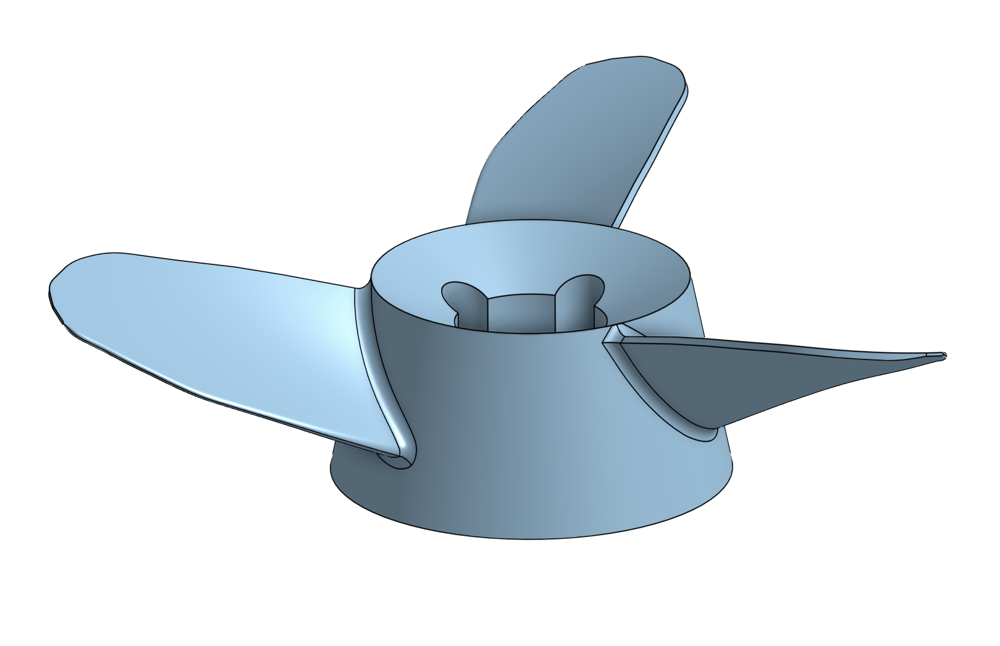

## What they build

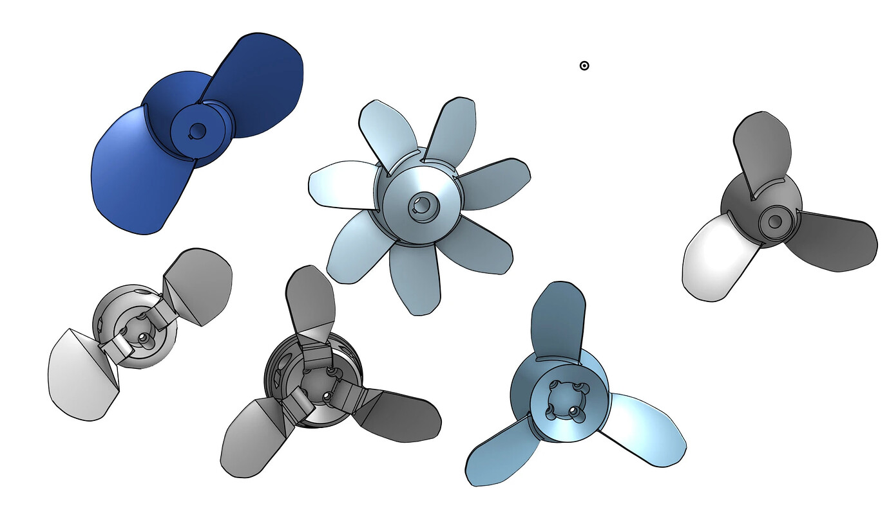

**B-Series Propeller** makes one solid for a fixed propeller: the blade lofted from Wageningen B-series data, patterned round the shaft axis, joined to a tapered hub with a root fillet, with a nose or tail cap, a bore, a keyway or a bolt circle. For a folding propeller it makes a hub body and one blade body per blade, each on its own pin, with the boss, the tongue, the stop, the tail relief and the fold clearances built in, and shows the set deployed or folded.

**Universal B-Series Blade Engine** makes one blade, lofted from r/R = 0.2 to the tip, over-extended inboard so that a boolean union with any hub of yours closes without a gap. You pattern it and join it yourself. The blade fields are the same in both features.

Both add a mate connector on the shaft axis at the origin, and both print a log to the FeatureScript notices panel and to the Part Studio variables `propLog` and `propNotice`, which is where the operating check and every warning go.

**Propeller mold**, **Propeller model from part** and **Core forging mold** are covered in their own chapter, *Molding the propeller in carbon*, after the troubleshooting table. Each writes its own log and notice: `moldLog` and `moldNotice`, `partModelLog` and `partModelNotice`, `forgeLog` and `forgeNotice`.

## Conventions

| Term | Meaning |
|---|---|
| Z axis | The shaft centreline. The finished propeller is shown aft up: its tail points to +Z and it travels toward -Z, the way it sits on a bench. The suction side of the blade faces the direction of travel. (The log's z values are in the maths frame, +Z upstream.) |
| Upstream, downstream | Upstream is the end that meets the water first, shown pointing down. On a motor-mounted propeller the upstream face sits against the bell. |
| Origin | The centre of rotation, on the blade root plane. The hub is centred on it unless Axial shift moves it. |
| r/R | Fractional radius: 0 on the shaft axis, 1 at the tip. The blade's chord and pitch tables are quoted at 0.7R. |
| Direction | CW from astern is a right-handed propeller, the marine convention: clockwise seen from behind, looking forward. CCW is its true mirror. Match it to the motor's direction in the ESC. |
| P/D | Pitch over diameter, at 0.7R. EAR: expanded area of all the blades over the disc area. |

## Quick start

**A fixed propeller for a 63-series outrunner.** Apply B-Series Propeller. Set Diameter 140, P/D 0.9, EAR 0.3, Blades 3. In Hub: Upstream dia 63, Downstream dia 50, Hub length 30, Tail style Dish, Tail pocket 24, Pocket floor 12. In Mount: Bolt circle, M4, 4 bolts on the motor's PCD (read it off the bell), Bolt flange 7. In Operating check: your motor kV, cells, ESC limit and phase resistance, and a cruise speed. Turn on Print to notices and read the check. Sections 12 while you iterate, 25 to 30 for the print.

**A folding propeller.** As above, then Hub type Folding. The defaults (pin at 20 mm radius on a 63 mm hub, boss 14 x 10, gap 12, clearance 0.3, fold 90°) build. Turn on Show folded to see the blades laid back and check that the tips clear the hub and each other; turn it off to work on the blade. The log's `folder:` and `tail relief:` lines tell you what was built and where it is tight; the section on the folder below says what to move.

**A carbon propeller.** Build the fixed propeller as above with Hub core on in the Hub group, then add Propeller mold below it with every field at its default. It finds the propeller by itself. Read its notice, then turn on Cut templates for the ply outlines. The chapter on molding says what each piece is for.

**One blade on your own hub.** Apply Universal B-Series Blade Engine with Hub diameter set to your hub's diameter where the blade meets it. Model the hub as a separate body, circular pattern the blade, boolean union.

<table style="border:none;width:100%;page-break-inside:avoid"><tr><td style="border:none;width:50%;text-align:center;vertical-align:top">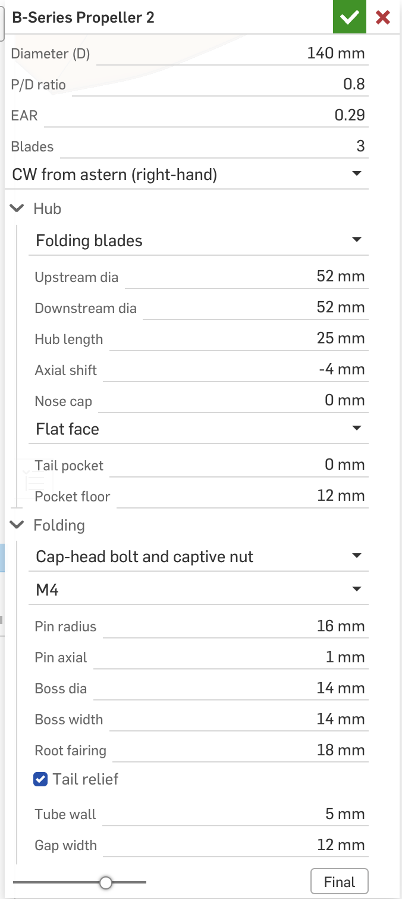</td><td style="border:none;width:50%;text-align:center;vertical-align:top">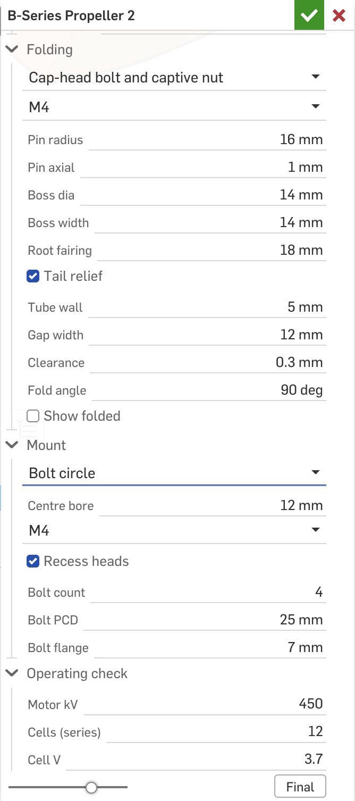</td></tr><tr><td style="border:none;font-size:8.5pt;color:#555;text-align:center">The B-Series Propeller dialog: the main fields, the Hub group and the top of the Folding group.</td><td style="border:none;font-size:8.5pt;color:#555;text-align:center">The Folding, Mount and Operating check groups.</td></tr></table>

## Main dialog

| Field | What it does | Typical | Accepts |
|---|---|---|---|
| Diameter (D) | Tip-to-tip diameter. The blade runs from 0.1 D to 0.5 D from the axis. | 140 to 200 mm | 50 to 1000 mm |
| Hub diameter (Blade Engine only) | The hub the blade joins. Sets where the root thickness is measured and where the taper and skew start. | 0.3 to 0.4 D | 0.22 to 0.6 D |
| P/D ratio | Pitch over diameter at 0.7R. Each section sits at atan(pitch / 2 pi r). Lower for low-speed thrust, higher for top speed. | 0.7 to 0.9 | 0.2 to 2.0 |
| EAR | Expanded area ratio of the whole propeller. Wider blades grip more and cavitate later, and drag more. The ceiling is the hub: the blades touch when blades x chord exceeds the hub circumference, and the feature warns. | 0.3 to 0.65 | 0.1 to 1.3 |
| Blades | Blade count. EAR is the whole propeller's, so one blade's chord is K x D x EAR / Z: a two-blade at EAR 0.2 has the same blade as a three-blade at 0.3. The 2 to 3 blade outline table applies up to three blades, the 4 to 7 one above. In the Blade Engine it only sizes the chord and builds one blade. | 3; 2 for a folder that must stow flat | 2 to 7 |
| Direction | CW from astern (right-hand) or CCW (its mirror). | CW | |

## Hub group (B-Series Propeller)

| Field | What it does | Typical | Accepts |
|---|---|---|---|
| Hub type | Fixed blades: one solid, blades filleted to the hub. Folding blades: each blade on its own pin in a slot, the Folding group applies. | Fixed on a motor; Folding on a foil that is also sailed, paddled or towed | |
| Upstream dia | Hub diameter at the upstream face. The hub is a straight taper to the downstream diameter. | the motor's diameter, 63 on a 63-series | 10 to 300 mm |
| Downstream dia | Hub diameter at the downstream face. | 0.8 x upstream; equal for a cylinder | 10 to 300 mm |
| Hub length | End face to end face, before any cap. The blade root plane sits at its middle. On a tapered hub the blade is built to the hub's diameter at that plane, which the log reports as the hub diameter. | 20 to 50 mm | 5 to 300 mm |
| Axial shift | Moves the hub along the shaft relative to the blade root plane, positive upstream. | 0; a few mm aft when raked tips overhang | -100 to 100 mm |
| Nose cap | A cone on the upstream face down to a fifth of the diameter. 0 leaves it flat, right against a motor bell. | 0 against a motor; 0.25 to 0.5 x hub dia free | 0 to 200 mm |
| Tail style | Flat face; Cone cap (a convex cone closing the wake behind a hub in the flow); Dish (a concave cone cut into the face at Dish angle, the bolt heads inside it, less printed mass). | Dish behind a motor; Cone cap in the flow | |
| Tail cap | Length of the cone cap. | 0.5 to 1 x downstream dia | 1 to 200 mm |
| Dish angle | The dish's cone from the face plane. It must stay clear of the upstream face by the pocket floor, or the feature warns and flattens it. | 30° | 5 to 60° |
| Tail pocket | A pocket along the axis from the downstream end for the shaft end, a nut or a circlip. 0 for none. | 24 mm over a 10 mm shaft end | 0 to 200 mm |
| Pocket floor | Wall between the pocket floor and the upstream face, the solid that carries the blades and the bolts. | 10 to 14 mm; at least the bolt flange plus a few mm | 2 to 200 mm |
| Root fillet | Fillet where each blade meets the hub. Tried last; if the kernel refuses it the propeller builds without it and a warning says so. | 2 to 4 mm | 0 to 20 mm |
| Hub core | Also builds the printed core a one-piece carbon propeller is laid up round: the hub inset by Skin thick on its sides and both faces, with the same bore, keyway or bolt circle, dish and pocket, as a separate body named *Hub core*. The Propeller mold reads it for the laminate. | off for a printed propeller; on for a molded one | |
| Skin thick | Laminate over the core on the hub's sides and faces. | 1.5 mm: seven plies of 200 gsm woven at 50 % fibre | 0.5 to 4 mm |

## Folding group

The folder is built so that the hub is never cut for the blade beyond the tongue slot and the pin holes. The blade's root and its fairing are trimmed to the hub's outside profile deployed, and again wherever they would meet the hub on the way through the fold, in 6° steps. So a long hub behind the pin costs root area on the blade, and the log reports how much it took off.

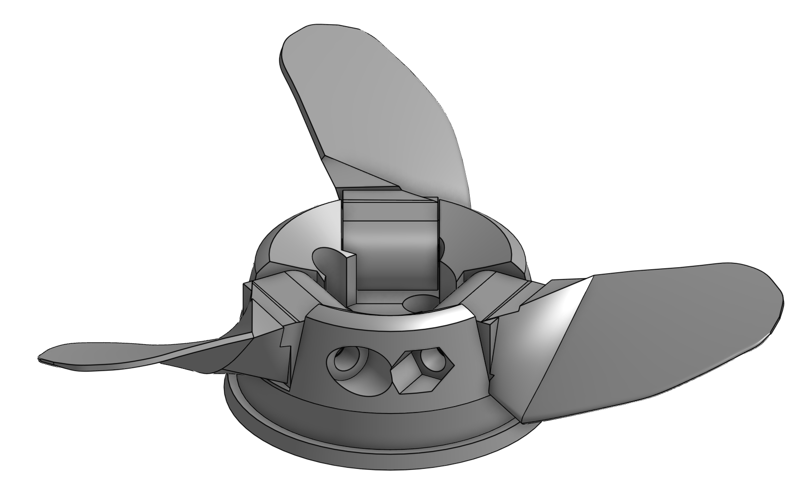

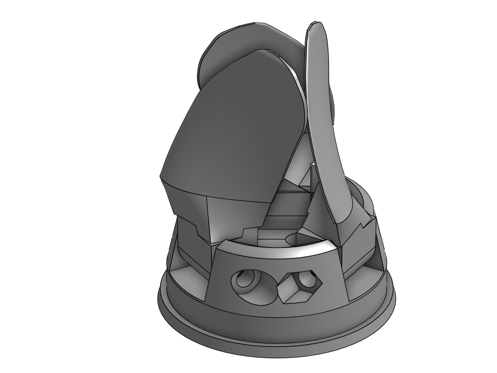

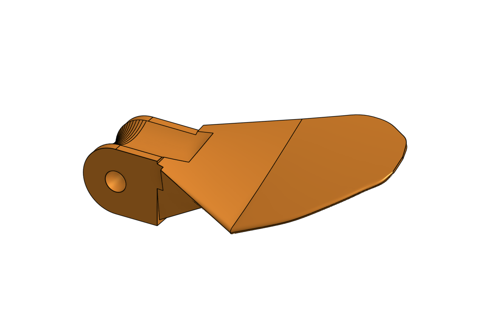

| Field | What it does | Typical | Accepts |
|---|---|---|---|
| Pin type | Straight pin: a plain pin pressed into the cheeks, running in the boss, a pin body made per blade. Cap-head bolt and captive nut: an ISO socket head cap screw through the cheeks and the boss, head counterbored on one cheek, hex nut pocketed on the other, so the pin comes out without a press. | a 4 mm stainless pin, or an M4 bolt | |
| Pin bolt | The bolt's metric size: ISO 273 clearance holes, ISO 4762 head counterbore, ISO 4032 nut pocket. Custom uses Pin dia as the hole. | M4 | M3 to M8, Custom |
| Pin dia | The straight pin, or the hole for a custom bolt. | 4 mm to 160 mm; 5 mm on a 200 | 2 to 12 mm |
| Hub fit | Added to the pin diameter for the cheek holes: negative for a press fit. | -0.1 mm printed (ream if needed) | -0.5 to 0.5 mm |
| Blade fit | Added to the pin diameter for the boss bore, the running clearance. | 0.2 mm printed, 0.1 reamed | 0 to 1 mm |
| Pin bodies | A pin body per blade, cut flush with the hub, for the drawing and the parts list. | on | |
| Pin radius | Distance of the pin axis from the shaft axis. The pin lies tangential, across the blade's radial line. Further out: a longer cheek behind the pin, a shorter tongue. Further in: more cheek wall, and a thinner core behind the pins. | 0.6 to 0.7 x hub radius (20 on a 63 hub, 17 on a 52) | 5 to 250 mm |
| Pin axial | Axial offset of the pin from the root's generator line, positive upstream. The part of the root section aft of the pin swings in toward the shaft when the blade folds, so a pin further aft (negative) leaves a bigger core behind the pins. On a wide root this is the lever. | 0; -5 to -10 mm on a two-blade or a wide root that reports a thin core | -100 to 100 mm |
| Boss dia | The cylindrical boss round the pin and the height of the tongue. The slot is this plus twice the clearance. Keep it under the root section so the tongue hides inside the root. | 3 x pin dia, 12 to 16 mm | 5 to 60 mm |
| Boss width | Boss and tongue along the pin: the bearing length on the pin and the thickness that takes the stop load. Wider bosses leave narrower cheeks. | 8 to 12 mm on a 63 hub | 3 to 40 mm |
| Root fairing | Length outside the hub over which the aerofoil is lofted down to the tongue's section, so the root blends into the boss. 0 leaves the bare tongue. | 0.25 to 0.4 x root chord, 8 to 12 mm | 0 to 60 mm |
| Tail relief | Turns the hub's trailing end behind the pins down to a round shoulder about the pin circle with a core tube behind it, all the way round, so the root's leading edge swings aft clear of the cheeks. Off leaves the hub whole and lets it trim the root instead. | on | |
| Tube wall | Keeps a tube of the bore plus this wall solid through the gap and the relief, and shapes the boss, tongue, fairing and root round it through the whole fold. For pins close to the shaft. Needs a bore. | 0; 2 to 3 mm when the core is reported thin | 0 to 10 mm |
| Gap width | The opening between the cheeks that the boss and root swing through, whose forward wall is the stop. The cheeks between the gaps carry the pins: leave them 3 to 4 mm plus the head or nut pocket. | boss width plus 2 to 6 mm | 4 to 100 mm |
| Clearance | Between the boss or root and the cheeks, the root and the hub surface, and the trimmed root and the hub through the fold. | 0.3 mm printed | 0.1 to 2 mm |
| Fold angle | How far the blade swings aft. 90 lays it along the shaft. | 90°; 100 to 110 to tuck the tips against a tapered hub | 30 to 150° |
| Show folded | Rotates the blades to Fold angle and checks that they clear the hub and each other. The parts are built the same either way. | off to design, on to check | |

**Reading the folder's log.** With Print to notices on, the `folder:` line gives the pin's position, the pin length, the boss, the gap's extent and the stop, the cheek width between gaps and the fold; the `root section` line gives the root chord where the aerofoil starts and how far it reaches aft and forward of the pin; `tail relief:` gives the shoulder and the core diameter behind the pins; `trimmed against the hub` says how much the fold trim took off the root. Three warnings matter:

- *The cheeks between the gaps are only N mm.* Narrow the gap, widen the hub, or move the pin out.
- *Behind the pins the tail relief leaves an N mm core over the bore: under 3 mm of wall.* The root's reach aft of the pin swings into the core when the blade folds. Move the pin aft (Pin axial), set a Tube wall so the shaft tube stays and the root is shaped round it, move the pin out, lower EAR, or turn Tail relief off.
- *The fold trim failed at one position.* The kernel could not cut the root against the hub at that angle; check the folded blade by eye there.

## Mount group

| Field | What it does | Typical | Accepts |
|---|---|---|---|
| Mount type | None: a solid hub to bore later. Plain bore: for a threaded, pressed or grub-screwed shaft. Bore and keyway: for a keyed shaft. Bolt circle: holes on a pitch circle in the downstream face, with an optional centre bore, for an outrunner bell. | Bolt circle on a 63-series; Bore and keyway on a geared drive | |
| Bore dia | Through bore. Tapping drill for a threaded shaft; shaft plus clearance for a keyed one. | 10.2 on a 10 mm shaft; 6.8 for M8 | 1 to 100 mm |
| Keyway width, depth | The keyway along the bore; depth beyond the bore radius. | 3 mm wide, 1.4 deep on a 10 mm shaft | |
| Centre bore | A bore at the centre for the shaft end or a spigot, with a bolt circle. 0 for none. | 12 over a 10 mm shaft end | 0 to 100 mm |
| Bolt size | Sets the ISO 273 clearance hole and the ISO 4762 head recess plus 1 mm. Custom shows Bolt hole dia and Head dia. | M4 on a 63-series bell, M3 on a 50 | M3 to M8, Custom |
| Recess heads | Counterbores the heads from the downstream end up to the flange. Off leaves plain holes. | on | |
| Bolt count, PCD | Holes equally spaced on the pitch circle in the downstream face. | 4 on 25 to 32 mm on a 63-series; read it off the motor | 2 to 12 |
| Bolt flange | Wall left under the heads at the upstream face; sets the thread engagement. | 6 to 8 mm | 1 to 100 mm |

The bolt circle is the mount's weak point on a printed hub, and so is a keyway: see Loads below.

## Advanced group: the blade's shape

| Field | What it does | Typical | Accepts |
|---|---|---|---|
| Tip pitch, % | Pitch at the tip relative to nominal; nominal to 0.7R, then blended parabolically. | -10 %; -15 to -20 if it ventilates or sounds harsh | -30 to 30 % |
| Skew (+ back) | Sweeps the blade round the shaft from the hub surface to the tip. Positive sweeps back against rotation, softening the load as each blade passes the mast. | 0 to 25° | -60 to 60° |
| Root thick. | Maximum section thickness where the blade leaves the hub: the strength number. Inside the hub it keeps thickening on the same curve. | 6 to 9 mm on a 150, about 0.045 D | 1 to 50 mm |
| Rake (+ aft) | Tilts the blade along the shaft. Positive leans the tip aft, relieving root bending. A folder needs it aft. | 5 to 15° | -30 to 45° |
| Taper exponent | How thickness falls root to tip: 1 linear (B-series, stiffer), 2 parabolic (thinner, less drag). | 1 for a print; toward 2 once one survives a season | 1 to 3 |
| Section profile | The section shape at every radius; see the table below. Only the B-series matches the operating check's polynomials. | B-series | |
| Camber % | Maximum camber, for the NACA, Eppler and biconvex profiles. Ignored by the B-series and the ogival. | 2 to 4 % | 0 to 10 % |
| Tip thick. | Section thickness at the tip. Thin tips are quiet and chip on grounding. | 1.2 to 2 mm, at least 2 to 3 extrusion widths | 0.2 to 20 mm |
| Edge thick. | The square-cut trailing edge, and the thickness the rounded nose is built from. Under 0.8 mm it will not print as modelled and the root gets hard to cap. | 0.8 to 1.2 mm with a 0.4 nozzle | 0.2 to 10 mm |
| Tip chord | Blade width at the very tip, since the published chord goes to zero there. Must be under half the chord at 0.9R. | 0.04 to 0.07 D | 1 to 200 mm |
| Round tip | Closes the tip with an elliptical dome over the last 2 % of radius. | on | |
| Sections | Section profiles lofted from 0.2R to the tip, denser outboard. | 12 iterating, 25 to 30 final | 6 to 60 |
| Keep sections | Leaves the section curves in the Part Studio. | off | |
| Print to notices | The inputs, the station table, each stage, the folder and the operating check to the notices panel and the `propLog` variable; a failure becomes a warning with its message so the log survives. | on while designing | |
| Sections only | Builds the section curves and stops. For when the loft fails. | off | |

## Section profiles

The B-series carries its own tabulated ordinates and ignores Camber: cambered inboard, flat-faced from about 0.7R out. Every other profile is a normalised thickness distribution plus a camber line scaled by Camber %. Changing the profile leaves chord, pitch, thickness and planform alone, so it is a clean comparison. In water the choice is about cavitation before drag: a section whose suction peaks at the nose cavitates and ventilates first, whatever its lift-to-drag ratio.

| Profile | Crest | Character |
|---|---|---|
| B-series | varies | Matches the operating check. Proven; flat-faced outboard, so a narrow angle range before the suction peak spikes. |
| NACA 16 | 0.50c | The classic propeller and cavitation section, load spread by the a = 0.8 mean line. Thin nose: set the camber sensibly. |
| NACA 66-style | 0.45c | The modern marine shape, the widest cavitation-free range at a given loading. An approximation of the published ordinates. |
| Eppler-Shen YS-920, Eppler E817 | 0.34c, 0.33c | Aft-loaded marine sections with the camber peak near two thirds chord, which keeps the suction peak off the nose. The best bet against cavitation and ventilation near the surface. |
| NACA 4-digit, Clark Y | 0.30c | Blunt-nosed and forgiving at low Reynolds number; Clark Y is flat underneath, a clean print surface. |
| Ogival, biconvex, elliptical | 0.50c | Simple forms: the flat-faced workboat section, a symmetrical arc, and the gentlest pressure distribution of all at the cost of efficiency. |

A sanded, filled and sealed blade beats a raw print with a better section. For a comparison print, NACA 16 or YS-920 at 2 % camber against the B-series is the pair that shows the clearest difference.

## Operating check

Enter the motor and battery and the check prints the propeller's operating points to the notices panel. It never touches the geometry. Leave Motor kV at 0 and nothing is calculated.

| Field | What it does | Typical |
|---|---|---|
| Motor kV | rpm per volt at no load. No-load speed is kV x pack volts / gear ratio. | 100 to 160 on 12 to 14S |
| Cells (series), Cell V | Pack voltage is cells x Cell V. 3.7 is a mid-discharge nominal; 4.0 to 4.1 a fresh pack under load; 3.4 near empty. | 12S at 3.7 |
| Torque const | Torque constant x kV. 9.55 is 60 / 2 pi, what a datasheet's mNm/A x kV comes to. | 9.55, or the datasheet's figure |
| ESC limit, A | Motor phase current limit in the ESC. Torque at the limit is the constant x this. | 80 to 150 |
| Gear ratio | Motor turns per propeller turn. | 1 direct; 4 to 5 geared |
| Phase R, mOhm | Phase resistance. With it, the current available falls as the back-EMF nears the pack voltage. 0 flatters the cruise figure. | 20 to 50 on a 63-series |
| Cruise, km/h | The speed to report at, alongside static. | 20 to 30 |
| Cruise drag, N | The foil's total drag at that speed, from the Foil Design Tool's sweep or a log. Adds the steady cruise point: rpm, efficiency, amps, volts, throttle, watts in, Wh/km. | 80 to 120 N at 20 to 25 km/h |
| Depth | The shaft axis below the surface, for the cavitation number. | 500 to 700 mm |

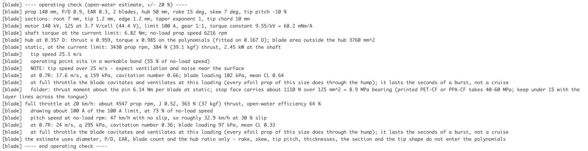

**What it reports.** Shaft torque at the current limit and the no-load propeller speed. The hub's share taken off the polynomials (they were fitted on a 0.167 D hub; a bigger hub blanks the inner blade). Static at the limit: the rpm at which the propeller absorbs exactly the available torque, thrust in N and kgf, shaft power, tip speed, and where the point sits between stall and no-load. Full throttle at the cruise speed: rpm, advance ratio, thrust, open-water efficiency, the current drawn. Steady cruise against the drag: rpm, efficiency, motor amps and volts, throttle, watts in and Wh/km at the motor terminals. At each point the cavitation number at 0.7R against the blade loading, with a verdict. For a folder, the thrust moment about the pin and the bearing stress on the stop face.

The warnings: an operating point above no-load speed means the propeller is under-pitched or too small; under 35 % of no-load, over-pitched or too large; a tip speed over 25 m/s, ventilation and noise near the surface; cruise hard against no-load speed, raise P/D or cells, lowering pitch makes it worse.

**Accuracy.** The polynomials use diameter, P/D, EAR, blade count and the hub ratio only; rake, skew, tip pitch, thickness, section and tip shape do not enter. Treat every figure as an open-water estimate to about ±20 %. Static thrust is the most reliable number; the cruise energy reads low against a real rig, which has motor iron and no-load losses, the pod's wake on the prop and a mast that the check leaves out. Use it to compare your own designs and to catch a mis-sized drive before a print, and trust your own logs over it.

## Warnings, errors and what to change

| Message | Cause and fix |
|---|---|
| Blades will touch or overlap at the hub / overlap badly | Blades x chord at the hub exceeds the circumference. Lower EAR, raise the hub diameter, or fewer blades. |
| Section wraps N deg round its radius and folds onto itself; Section is N mm thick on an N mm chord and cannot close; could not cap the root section | The root is too wide or too thick for its radius. Every message that EAR can cause ends with the reason in brackets: EAR over the blade count, the chord that gives at the hub and what part of the hub circumference it is. Lower EAR, raise the diameter or the hub, more blades, or lower Root thick. or Taper exponent. |
| Tip chord must be under half the chord at 0.9R | Reduce Tip chord. |
| Edge thickness is too large for the chord | The rounded nose would swallow the section. Raise Tip chord or lower Edge thick. |
| The pin lies outside the hub; Pin radius plus the boss reaches past the hub surface | Move the pin in, shrink the boss, or lengthen the hub. |
| The gap floor reaches the shaft axis | Move the pin out, shrink the boss, or set a Tube wall. |
| The tail relief's core reaches the shaft axis | Pin outward or aft (Pin axial), a Tube wall, lower EAR, or Tail relief off. |
| The shaft tube reaches the pin holes | A thinner Tube wall, a smaller bore, or pins further out. |
| Trimming the blade to the hub through the fold split it | The hub behind the pin takes too much root. Shorten the hub behind the pin, move the pin aft, lower EAR, or reduce the fold angle. |
| The root fillet failed | Built without it; lower the fillet, or reduce skew or rake at the root. |
| Sections are crowding at the tip | Lower the section count. |

## Printing, materials and loads

Print the blades with the layers along the span: trailing edge on the bed, as the foil.zone thread does. The root bending stress then runs within the layers, and the layer bond carries only the small chordwise and shear loads. Standing on the root, the same stress crosses the layer lines, which is where printed blades fail. Dry the filament, seal the surface, and balance the set.

Where the loads go, in order of what fails first on a printed propeller:

- **The blade root** carries the bending, and it is set by the root's thickness more than anything else: bending stress goes with the inverse square of the thickness, so a 5 mm root runs at about twice the stress of a 7 mm one. The centrifugal load is small beside it. Rake aft helps a little. On a printed blade keep Root thick. at 6 to 9 mm on a 150 mm prop and print solid.
- **The folder's pin** is loaded in bending between the cheeks, not just in shear: the blade's moment is carried as a couple between the pin and the stop. The operating check prints that moment about the pin and the bearing stress on the stop face for your drive. A stop further from the pin unloads everything in the folder in proportion; keep the stop faces generous and use a 5 mm pin on a prop run hard.
- **The printed keyway** is the hub's weak part on a keyed shaft: 10 Nm on a 10 mm shaft is 2 kN on a 3 mm key, about 60 MPa of bearing on the printed flank, which is close to what a carbon-filled polyamide takes. Use the key's full length, a second key, or a bolt circle, which spreads the same torque over several bolts in shear and is the better mount on a printed hub.
- Everything else, the boss bore, the cheeks, the stop face, the tongue, the hub's hoop stress, sits at a small fraction of the material's strength.

Materials the thread has run: PPA-CF for a final prop; PET-CF and PETG-CF as test articles; PLA and PETG fail at the root. A shed blade under water is a non-event on a foil with three blades: the hub keeps the others, and the board comes off the foil.

## Troubleshooting

| Symptom | Likely cause and fix |
|---|---|
| The loft or a cap stage fails | A thin trailing edge on a wide, heavily wrapped root. Edge thick. 0.8 to 1.2 mm, lower EAR, or fewer sections. Sections only shows whether the curves are sound. |
| A fin or ripple near the tip | Tip chord over half the 0.9R chord, or stations crowding at the tip. |
| The blade looks blobby along the shaft | Expected: the sections are wrapped onto cylinders, and a wide blade at low blade count wraps a long way round the axis. |
| The feature regenerates slowly | The folder trims the blade in 6° steps through the fold and shapes it round the tube; 12 sections while iterating, and Show folded off. |
| The operating check prints nothing | Motor kV is 0. |
| A number in the log does not match the dialog | Read the build line at the top of the log; a pasted log from an older build is the usual cause. |

## Molding the propeller in carbon

A printed blade fails at the root. The answer these three features build toward is a fixed propeller laid up as one carbon part, hub and blades together, in a printed mold, round a core that carries the bore, the keyway or pin slot and the tail pocket. Nothing here is needed for a printed propeller.

The order of work: build the fixed propeller with **Hub core** on; add **Propeller mold** below it and read its notice; turn on **Cut templates** once the design is settled; print the mold, the core and the templates. For a propeller drawn in another CAD, import it as a STEP and add **Propeller model from part** before the mold. To make the core in forged carbon rather than printing it, add **Core forging mold**.

### Why the mold has sectors

Every blade surface releases along the shaft, because the sections lean but never past the axis, so two halves pulled along the shaft form the blades with the seams on the leading and trailing edges, as a wing mold does. The hub is the exception. Beside each blade root the hub's side sits in the shadow of the root's own chord, a small triangle on each side of every root that neither half can reach. A well round the hub in one half holds a ring of small radial **sectors** that form those patches: a root sector under each blade and a gap sector between neighbours, each pulled outward after the halves open. The mold's release check finds the shadows; outside the well it should find nothing.

<table style="border:none;width:100%;page-break-inside:avoid"><tr><td style="border:none;width:50%;text-align:center;vertical-align:top">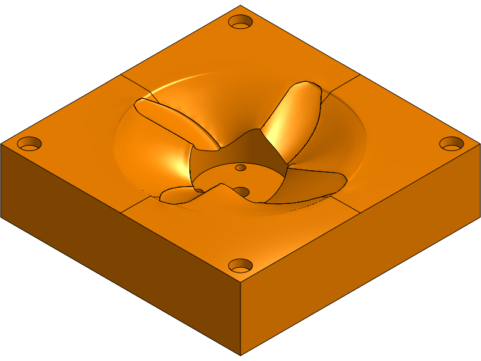</td><td style="border:none;width:50%;text-align:center;vertical-align:top">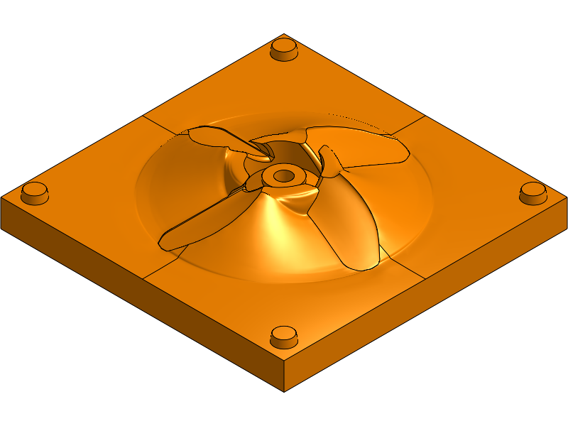</td></tr><tr><td style="border:none;font-size:8.5pt;color:#555;text-align:center">The nose half: the blade backs, the well for the sectors, the half-key sockets at the corners.</td><td style="border:none;font-size:8.5pt;color:#555;text-align:center">The tail half: the blade faces, the tail dish and pocket, the half keys.</td></tr><tr><td style="border:none;width:50%;text-align:center;vertical-align:top">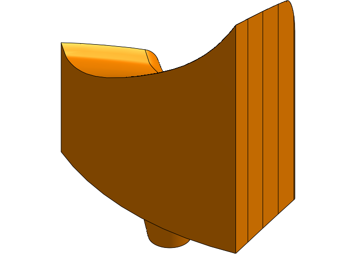</td><td style="border:none;width:50%;text-align:center;vertical-align:top">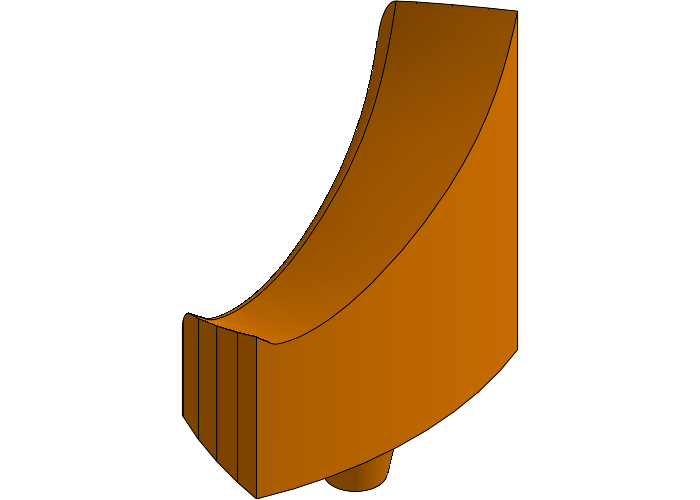</td></tr><tr><td style="border:none;font-size:8.5pt;color:#555;text-align:center">A root sector: the underside of one root and the hub beneath it, with its key.</td><td style="border:none;font-size:8.5pt;color:#555;text-align:center">A gap sector between two roots.</td></tr></table>

### Propeller mold

Select the propeller in **Part**, or leave it empty to take the last fixed B-Series Propeller above. The feature reads the model that feature publishes (the sections, the hub, the bore) and builds: a nose half and a tail half parted on each blade's own mean surface; the well and its sectors, keyed into the well floor; four frustum half keys at the flange corners; a rod hole for a waxed steel rod that forms the bore and locates the core; plugs that keep resin out of recesses in the hub's end faces; and, on request, the cut-template plate. It does not model stock, clamps or fixtures.

| Group | Fields and what they do | Typical |
|---|---|---|
| Block | **Flange width** round the tip circle for clamps and keys; **Base thick** under each half's deepest point; **Sector band**, how far the sectors reach beyond the hub and fillet; **Sector fit**, **Key dia**, **Key height**, **Half key dia**, **Rod fit**; **Plug engage**, how far a recess plug reaches into the core's own recess; **Gap points**, the parting's resolution between blades. | 25, 18, 8, 0.1, 6, 5, 14, 0.1, 2, 6 |
| Pinch-off | **Pinch-off groove**: a narrow land at the cavity edge and a flash groove beyond it round every blade, in the half the plies are laid on. **Land width**, **Groove width**, **Groove depth**. | on; 3, 4, 1.5 mm |
| Closing | **Closing**: clamps on the flanges against a board each side, or a vacuum bag round the whole mold; no bolts. **Bag vacuum kPa**; **Groove vents** from each blade's groove to the block edge, so flash can leave under a bag; **Edge round** so the bag is not cut. **Pry sections**: short 45° V pockets across the parting to start a wedge. **Ejectors**: holes onto the hub's end faces, as wax-filled dowel holes or printed flush plugs, to push out a part that stays in a half. | Clamps; 85 kPa; vents on; 5 mm; pry on; dowel holes 4 mm |
| Sectors | **Sector marks**: dots on each sector's base and its seat, to keep a fitted piece with its seat. **Pull hole**: a blind hole in each sector's outer face for a screw to draw it out, drilled along the line it releases on. | on; 3.3 mm for an M4 |
| Layup | **Skin plies**, **Skin gsm**, **UD gsm**, **Tab plies**, **Root tab**, **Fibre vol %**, **Overcharge %**, **Cloth waste %**, **Resin waste %**: the cloth and resin, from which the notice counts the plies at every radius and the cloth and resin to buy. | 1 ply of 200 gsm woven each face, 300 gsm UD between, 2 tab plies of 12 mm, 50 %, 4 %, 25 %, 40 % |
| Cut templates | **Cut templates**: a 1 mm plate under the mold with every ply outline cut through it and a row of holes under each shape for its cut count. **Trim margin**, **Template gap**. | off until the design is settled; 4 mm, 10 mm |
| Checks | **Release check** along the shaft; **Log inputs**; **Keep log on error**, which turns a failure into a warning so the log survives. | on |

**Reading the mold's notice.** It gives the block's size, the pieces, the release check's result outside the well, each sector's release direction (a root sector usually comes out a few degrees off radial, and the pull hole follows that), the pinch-off's groove volume against the expected flash, the closing force under a bag, the layup line and the cloth through the templates. The layup line ends with the cavity fill: near 100 % is right; well over means too many plies for the cavity, under means too few.

**Cut templates.** The plate holds the blade skin's expanded outline, one outline per UD ply (each ply covers the part of the blade still thick enough to need it, ending in a point where it runs out), the tab plies with a notch at the fold, the hub's side panel between two roots, and the hub's end discs. The key in the log names each shape. Right-click the plate's top face and *Export as DXF* for a cutter, or print it at 1:1 as a paper pattern. On a part this small the trim margin is more cloth than the waste allowance, so buy from the templates' figure in the notice.

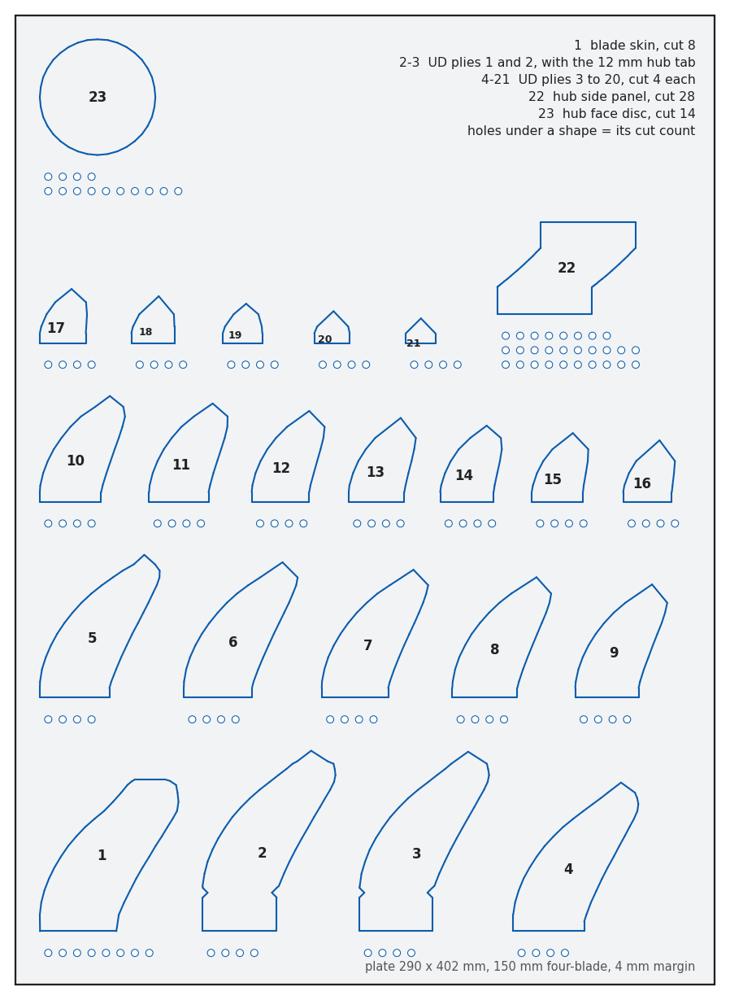

**Printing and using it.** One tile per half on a 250 mm bed for a propeller up to about 150 mm. Seal and release the printed surfaces as for any printed mold. Lay up in the half with the well: sectors in against the core, skin, UD and tabs, the hub skin over the tabs, then the other skin; close the halves on the edges and the hub ends, clamp or bag. To release: the nose half off, the part with its sectors out of the tail half, the rod out, the gap sectors outward first, then the root sectors with a screw in the pull hole.

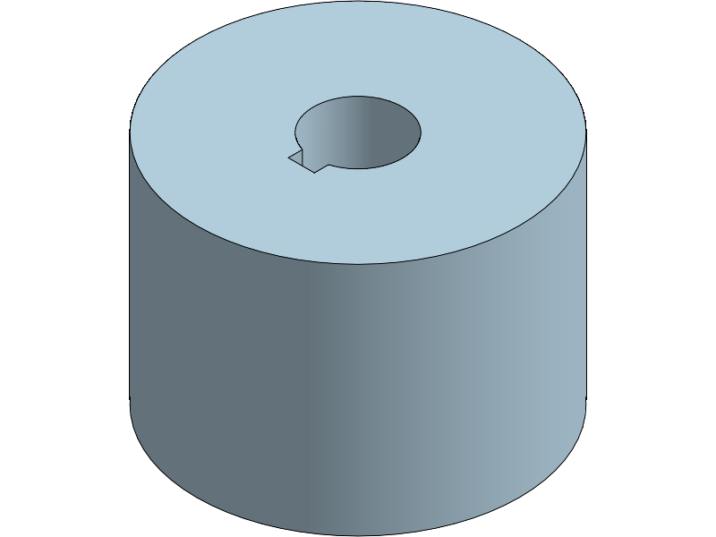

### Propeller model from part

For a propeller drawn somewhere else. Import its STEP, move it so the shaft lies along Z, and add this feature with the solid as **Part**. It finds the axis and the bore from the round faces, then the hub, the blade count and, at each of **Stations** radii, the chord, pitch angle, thickness, crest and mean line, with rays cast along the shaft through each blade. It publishes the same model the B-Series Propeller does, so a Propeller mold placed after it, with the same solid as its Part, molds that propeller exactly.

| Field | What it does | Typical |
|---|---|---|
| Nose end | Which end of the hub faces the water first: the leading edges are the blade edges toward it. | Bigger hub end |
| Stations | Radii measured from the hub out to the tip. | 30 |
| Root fillet | The fillet between the blade roots and the hub as modelled on the part; the mold sizes its sectors from it. | 2 mm |
| Hub core, Skin thick | Builds the printed core from the part itself, its hub inset by the skin, so every recess and slot of the part carries over. | on for a molded prop; 1.5 mm |

Its log, `partModelLog`, lists every station it measured. Check the pitch, chord and thickness against what the propeller's drawing says before printing a mold from it. The part's blades must release along the shaft, as any propeller this mold can make does.

### Core forging mold

A small printed press for making the hub core in forged carbon, chopped tow and epoxy pressed to shape, instead of printing it. A sleeve has the core's taper as its cavity and a parallel bore above it for the piston; a floor plug carries the small end's recesses as bosses; the piston carries the big end's and stops on its shoulder at the finished height. A steel tube forms the bore and a bolt through it closes the stack between two steel plates.

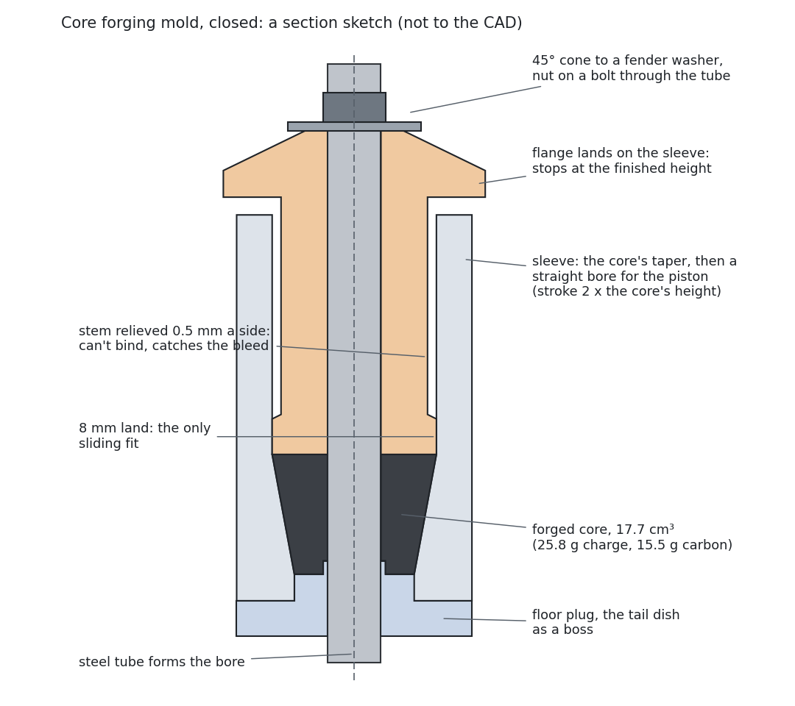

| Group | Fields and what they do | Typical |
|---|---|---|
| General | **Core**: the hub core to forge, or empty for the one the propeller features stamped. **Piston end**: which end the piston presses from; the bigger end lets the core's taper act as draft. | Bigger end |
| Mold | **Wall**, **Floor**, **Flange**; **Stroke x height**, the piston travel as a multiple of the core's height, since the loose charge takes about twice its finished volume; **Cone top** to a fender washer; **Land**, the piston's only sliding fit, with the stem **Relief** above it; **Lead-in** chamfer; **Clearance**. | 15, 10, 8 mm; 2; on; 8, 0.5, 1, 0.1 mm |
| Closing | **Tube wall**, **Bolt dia**, **Target MPa** on the charge (the notice gives the force and the nut torque in stages); **Pry sections**. | 1 mm, M8, 5 MPa |
| Charge | **Fibre wt %**; **Long tow %**, the share laid as continuous loops round the bore and the pin slot. | 60 %, 30 % |
| Strength | **Drive torque**, **Pin dia**, **Pin length**: the shaft's drive through a cross pin in a slot, checked against the forged core. | 12 Nm, 4 mm, 20 mm |

Its notice gives the charge by weight, the clamp force and the torque schedule, the sleeve's hoop stress and the piston flange's load against printed PETG, and the core's strength at the pin slot. `forgeLog` holds the whole technique step by step: printing, release, loading the charge, closing in stages, demolding and post-cure. Print the forging mold in PETG, solid, sleeve standing on its floor end; the pressure is far above a matched mold's.

## Changes since build 71

- **Propeller mold** (builds 72 to 108, pry sections and ejectors in 114): the printable mold for a fixed propeller laid up as one carbon part, with hub sectors, pinch-off, closing by clamps or a bag, the release checks, the layup line, cut templates, pry sections and ejectors.
- **Hub core** on the B-Series Propeller (build 86): the printed core the laminate wraps.
- **Propeller model from part** (builds 104 to 112): the mold for a propeller drawn in other CAD.
- **Core forging mold** (builds 109 to 114): a press for forging the hub core in chopped carbon.
- On a tapered hub the blade is built to the hub's diameter at the blade root plane (build 113).
- Build 115 changes text only.

## Credits

The blade outline, pitch and section tables are the Wageningen B-series (Kuiper, *The Wageningen Propeller Series*, MARIN 1992); the open-water polynomials are Oosterveld and van Oossanen (1975). The printed folding propellers that shaped the folder are the foil.zone thread "Three-Blade Folding Prop Experiment". The forging mold follows Easy Composites' published design for forged-carbon moulds. The operating check's hub correction was checked against e-Foil Holland's published propeller comparison (Kwint, July 2023). Section coordinates for the YS-920 and E817 from the UIUC airfoil database.
